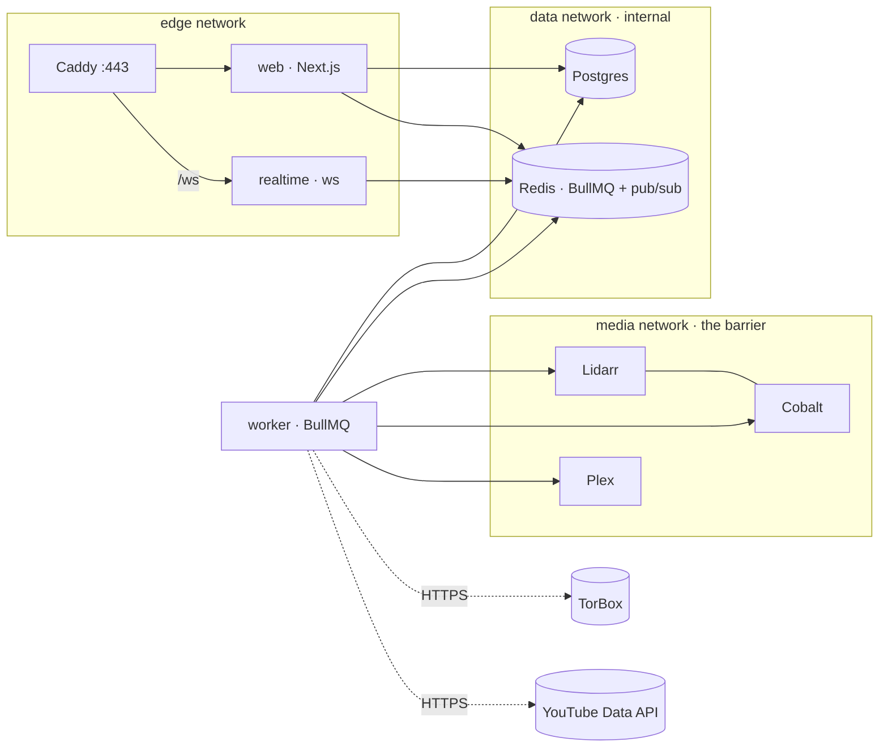

# Mint

Mint lives at **mint.chickenbone.dev**. It's a private music shelf: it syncs each member's YouTube Music likes and playlists, downloads the songs to the host, and serves them through Plex and Plexamp.

- **Public site.** Live stats, a live pipeline board (downloading → importing → sonic scan), library browsing with 30‑second previews, and a request‑access form.
- **Member dashboard.** A Spotify‑style app with liked songs, playlists, the library, per‑track job progress, sync settings, and an admin area for approving people.
- **Pipeline.** Lidarr and TorBox are tried first; a self‑hosted Cobalt rip is the fallback. Files are tagged and moved into the shared library, Plex scans them, sonic analysis runs, and per‑user Plex playlists are created.

## Architecture



| Package | Role |
| --- | --- |
| `apps/web` | Next.js 16: landing, browse, auth, dashboard, server actions, preview/artwork streaming |
| `apps/realtime` | WebSocket gateway. Relays Redis pub/sub to public, per‑user and admin channels, authenticated by the session cookie |
| `apps/worker` | BullMQ jobs: YouTube sync → match (MusicBrainz) → acquire (Lidarr+TorBox / Cobalt) → finalize (tag, preview, move) → Plex scan → sonic watch → playlists |
| `packages/core` | Drizzle schema and migrations, env, crypto, event bus, queue names, stats |

**The barrier.** `web` and `realtime` sit only on `edge` and `data`. Only the `worker` joins `media`, where Lidarr, Cobalt and Plex live. Cobalt has no published port, and Lidarr is bound to `127.0.0.1:8686` for setup. The public app never talks to them: it reads the database and the read‑only previews volume, and sends work through Redis queues.

**Privacy.** Public events show which tracks are moving through the pipeline, never who liked them. Google refresh tokens are encrypted at rest with AES‑256‑GCM (`ENCRYPTION_KEY`).

## Deploy

Requirements: a Linux host with Docker Compose v2, DNS `mint.chickenbone.dev → host`, and ports 80, 443 and 32400 open.

```bash
mkdir -p /srv/mint && cd /srv/mint
curl -O https://raw.githubusercontent.com/ChickenBone/mint/main/docker-compose.yml
mkdir deploy && curl -o deploy/Caddyfile https://raw.githubusercontent.com/ChickenBone/mint/main/deploy/Caddyfile
curl -o .env https://raw.githubusercontent.com/ChickenBone/mint/main/.env.example
openssl rand -base64 32          # → ENCRYPTION_KEY
openssl rand -base64 24          # → POSTGRES_PASSWORD (also update DATABASE_URL)
mkdir -p music blackhole/torrents blackhole/downloads && sudo chown -R 1000:1000 music blackhole
$EDITOR .env
docker compose pull && docker compose up -d
```

The worker runs migrations on start, and seeds the first admin from `ADMIN_EMAIL`/`ADMIN_PASSWORD` if no admin exists yet. Containers run as uid 1000, so keep `PUID`/`PGID` at 1000 or chown the folders to match.

### Google (YouTube Music linking)

1. In Google Cloud, create a project and enable **YouTube Data API v3**.
2. Set up the OAuth consent screen with the scope `https://www.googleapis.com/auth/youtube.readonly`. While the app is in *Testing*, add each member's Google account as a test user (maximum 100). Otherwise, submit the app for verification.
3. Create a **Web application** OAuth client with the redirect URI `https://mint.chickenbone.dev/api/oauth/google/callback`.
4. Put the client ID and secret into `GOOGLE_CLIENT_ID` and `GOOGLE_CLIENT_SECRET`.

Liked songs come from the YouTube "Liked videos" playlist, filtered to music. Member playlists can be toggled on or off individually.

### Lidarr + TorBox

1. Open Lidarr through an SSH tunnel: `ssh -L 8686:127.0.0.1:8686 host`, then browse to http://localhost:8686.
2. Add the root folder `/music`.
3. Under **Download clients**, add **Torrent Blackhole** with torrent folder `/blackhole/torrents` and watch folder `/blackhole/downloads`. Tick "Save magnet files".
4. Add indexers, directly or through Prowlarr.
5. Copy the API key into `LIDARR_API_KEY` and set `TORBOX_API_KEY`.

The worker sends each blackhole torrent or magnet to TorBox, polls it, and downloads the finished files into the watch folder for Lidarr to import. If nothing is grabbed within `LIDARR_GRAB_TIMEOUT_MINUTES`, the track falls back to Cobalt. Set `LIDARR_ENABLED=false` to use Cobalt only.

### Cobalt

Cobalt runs internally only. If YouTube starts answering "sign in to confirm you're not a bot", export YouTube cookies into `deploy/cobalt-cookies.json` (see the [cobalt docs](https://github.com/imputnet/cobalt/blob/main/docs/run-an-instance.md)). Then uncomment the cookie volume and `COOKIE_PATH` in `docker-compose.yml`. `COBALT_API_KEY` is only needed if you turn on Cobalt's API‑key auth.

### Plex

1. Get a claim token from https://plex.tv/claim and set `PLEX_CLAIM` before the first `up`. The token expires in 4 minutes.
2. Create a **Music** library pointing at `/music`, and turn on sonic analysis under Settings → Library.
3. Set `PLEX_TOKEN` (see [finding your token](https://support.plex.tv/articles/204059436)) and `PLEX_MUSIC_SECTION_ID` (the `?source=` number in the library URL).
4. Turn on Remote Access on port 32400.
5. **Share the library with each approved member** from Plex settings. This step is manual. Their liked songs then appear in Plexamp as the playlist `Mint · Name · Liked`.

## Development

```bash
npm ci
docker compose -f docker-compose.dev.yml up -d        # Postgres + Redis
cp .env.development.example .env                       # fill ENCRYPTION_KEY
npm run db:migrate
npm run dev:worker & npm run dev:realtime & npm run dev:web
```

Checks: `npm run typecheck`, `npm run lint`, `npm test`, `npm run build`.

## CI/CD

- **`ci.yml`** runs on every push and PR: typecheck, lint, test and build.
- **`release.yml`** runs on `main` and `v*` tags. It builds `ghcr.io/chickenbone/mint-{web,worker,realtime}` for amd64 and arm64, with provenance and an SBOM.
- **Auto‑deploy (optional).** Set the repository variable `DEPLOY_ENABLED=true` (and optionally `DEPLOY_PATH`), plus these secrets:
  - `DEPLOY_HOST`
  - `DEPLOY_USER`
  - `DEPLOY_SSH_KEY`
  - `DEPLOY_KNOWN_HOSTS` (from `ssh-keyscan host`)

  The job then runs `docker compose pull && up -d` over SSH.
- If the packages are private, run `docker login ghcr.io` on the host with a PAT that has `read:packages`.

## Notes

- **Previews.** Previews are 30‑second clips cut by the worker. Plex sonic analysis drives the "sonic scan" stage on the board, and Plexamp's Sonic Radio and Sweet Fades. You are responsible for making sure that sharing previews of your library publicly is lawful where you operate. Put the public pages behind auth if in doubt.
- **Unverified integrations.** Some assumptions about external APIs are untested against live instances: Lidarr's `?mbId=` and `?foreignAlbumId=` lookups, and Plex's `musicAnalysisVersion` as the "sonic done" marker. Check the worker logs on first run.
