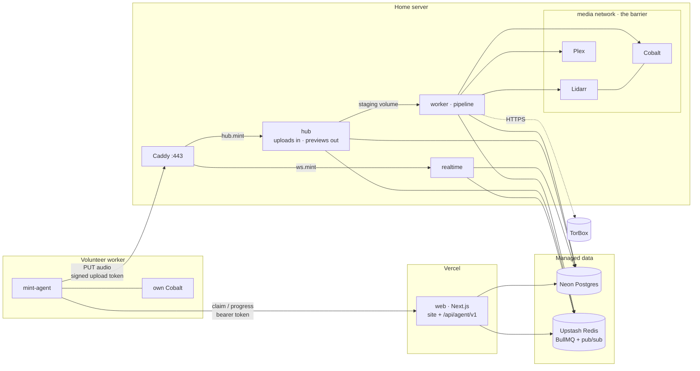

# Mint

Mint lives at **mint.chickenbone.dev**. It's a private music shelf: it syncs each member's YouTube Music likes and playlists, downloads the songs to the host, and serves them through Plex and Plexamp.

- **Public site.** Live stats, a live pipeline board (downloading → importing → sonic scan), library browsing with 30‑second previews, and a request‑access form.
- **Member dashboard.** A Spotify‑style app with liked songs, playlists, the library, per‑track job progress, sync settings, and an admin area for approving people.
- **Pipeline.** Lidarr and TorBox are tried first; a self‑hosted Cobalt rip is the fallback. Files are tagged and moved into the shared library, Plex scans them, sonic analysis runs, and per‑user Plex playlists are created.

## Architecture

Three places run code:

- **Vercel** hosts the website and the agent API.
- **Your home server** holds the music: Plex, Lidarr, Cobalt, the pipeline, the WebSocket gateway, and the upload hub.
- **Volunteer workers** are anyone's machine running one Docker image. They rip YouTube audio with their own Cobalt and upload the file to your hub.



| Package | Role |
| --- | --- |
| `apps/web` | Next.js 16: landing, browse, auth, dashboard, server actions, worker registration, and the agent API (`/api/agent/v1/*`) |
| `apps/realtime` | WebSocket gateway. Relays Redis pub/sub to public, per‑user and admin channels. Browsers authenticate with a signed 60‑second ticket from `/api/realtime/ticket` |
| `apps/worker` | Two entry points. `index.js` runs the pipeline: YouTube sync → match (MusicBrainz) → acquire (Lidarr+TorBox / volunteer pool / local Cobalt) → finalize (tag, preview, move) → Plex scan → sonic watch → playlists. `hub.js` takes volunteer uploads and serves previews and artwork |
| `apps/agent` | The volunteer worker (`ghcr.io/chickenbone/mint-agent`) |
| `packages/core` | Drizzle schema and migrations, env, crypto, the agent protocol, event bus, queue names, stats |

**The barrier.** Only the `worker` joins the `media` network, where Lidarr, Cobalt and Plex live. Cobalt and Plex's API have no route from the internet except Plex's own port, and Lidarr is bound to `127.0.0.1:8686`. Vercel never talks to the home server directly: it reads and writes the database and sends work through Redis queues. The hub has no Plex, Lidarr or TorBox credentials. It accepts a file only for a track whose lease the uploading worker currently holds, then checks it with ffprobe before the worker touches it.

**How a volunteer job flows.**
1. Lidarr/TorBox fails or times out.
2. If a volunteer worker is online (`REMOTE_DOWNLOADS=auto`), the track goes into the remote pool. Otherwise the home server rips it with its own Cobalt.
3. An agent claims the track. Claims use `FOR UPDATE SKIP LOCKED` and give a five‑minute lease that progress reports extend.
4. The agent rips the audio and uploads it to `hub.mint…/ingest/:id`.
5. The hub verifies the upload, releases the lease and queues `finalize`. The rest is the normal pipeline.
6. Expired leases go back to the pool. A track nobody takes within `REMOTE_WAIT_MINUTES` is ripped locally.

**Privacy.** Public events show which tracks are moving through the pipeline, never who liked them. Workers only receive a YouTube video ID, title and artist. Google refresh tokens are encrypted at rest with AES‑256‑GCM (`ENCRYPTION_KEY`). Worker tokens are stored as SHA‑256 hashes.

## Deploy

### 1. Data: Neon + Upstash

- **Neon.** Create a project and a `mint` database. Keep both connection strings: the **direct** one for the home server and the **pooled** one (`-pooler` host) for Vercel.
- **Upstash.** Create a Redis database in the same region and copy the `rediss://` endpoint. BullMQ polls Redis constantly, so pay‑per‑request plans add up quickly. Use a **fixed‑price** plan, or run Redis yourself with `--profile local-db` and expose it over TLS.

### 2. Home server

Requirements: Linux with Docker Compose v2, ports 80, 443 and 32400 open, and DNS records `ws.mint.chickenbone.dev` and `hub.mint.chickenbone.dev` → this host. Don't put the hub behind the Cloudflare proxy (orange cloud), because it caps request bodies at 100 MB.

```bash
mkdir -p /srv/mint/deploy && cd /srv/mint
curl -O https://raw.githubusercontent.com/ChickenBone/mint/main/docker-compose.yml
curl -o deploy/Caddyfile https://raw.githubusercontent.com/ChickenBone/mint/main/deploy/Caddyfile
curl -o .env https://raw.githubusercontent.com/ChickenBone/mint/main/.env.example
openssl rand -base64 32          # → ENCRYPTION_KEY
openssl rand -base64 48          # → MINT_SIGNING_SECRET
mkdir -p music blackhole/torrents blackhole/downloads && sudo chown -R 1000:1000 music blackhole
$EDITOR .env                     # Neon direct URL, Upstash URL, keys
docker compose pull && docker compose up -d
```

The worker runs migrations on start, and seeds the first admin from `ADMIN_EMAIL`/`ADMIN_PASSWORD` if no admin exists yet. Containers run as uid 1000, so keep `PUID`/`PGID` at 1000 or chown the folders to match.

**Self‑hosting the website instead of using Vercel.** Point `mint.chickenbone.dev` at the host, set `CADDYFILE=./deploy/Caddyfile.selfhost` and `NEXT_PUBLIC_WS_URL=wss://mint.chickenbone.dev/ws`, and add `--profile selfhost-web`. Add `--profile local-db` (with `POSTGRES_PASSWORD`, `DATABASE_URL=postgres://mint:…@postgres:5432/mint`, `REDIS_URL=redis://redis:6379`) to run Postgres and Redis locally too.

### 3. Vercel

1. Import `ChickenBone/mint` into Vercel.
2. Set **Root Directory** to `apps/web` and leave "Include files outside the root directory" on, because the app imports `packages/core`. Framework: Next.js, with the default build commands.
3. Add the variables from [`apps/web/.env.vercel.example`](apps/web/.env.vercel.example). `ENCRYPTION_KEY`, `MINT_SIGNING_SECRET` and the Google client must match the home server. `NEXT_PUBLIC_*` values are baked in at build time, so redeploy after changing them.
4. Add the domain `mint.chickenbone.dev` in Vercel and create the CNAME it asks for.

### Google (YouTube Music linking)

1. In Google Cloud, create a project and enable **YouTube Data API v3**.
2. Set up the OAuth consent screen with the scope `https://www.googleapis.com/auth/youtube.readonly`. While the app is in *Testing*, add each member's Google account as a test user (maximum 100). Otherwise, submit the app for verification.
3. Create a **Web application** OAuth client with the redirect URI `https://mint.chickenbone.dev/api/oauth/google/callback`.
4. Put the client ID and secret into `GOOGLE_CLIENT_ID` and `GOOGLE_CLIENT_SECRET`.

Liked songs come from the YouTube "Liked videos" playlist, filtered to music. Member playlists can be toggled on or off individually.

### Lidarr + TorBox

1. Open Lidarr through an SSH tunnel: `ssh -L 8686:127.0.0.1:8686 host`, then browse to http://localhost:8686.
2. Add the root folder `/music`.
3. Under **Download clients**, add **Torrent Blackhole** with torrent folder `/blackhole/torrents` and watch folder `/blackhole/downloads`. Tick "Save magnet files".
4. Add indexers, directly or through Prowlarr.
5. Copy the API key into `LIDARR_API_KEY` and set `TORBOX_API_KEY`.

The worker sends each blackhole torrent or magnet to TorBox, polls it, and downloads the finished files into the watch folder for Lidarr to import. If nothing is grabbed within `LIDARR_GRAB_TIMEOUT_MINUTES`, the track falls back to Cobalt. Set `LIDARR_ENABLED=false` to use Cobalt only.

### Cobalt

Cobalt runs internally only. If YouTube starts answering "sign in to confirm you're not a bot", export YouTube cookies into `deploy/cobalt-cookies.json` (see the [cobalt docs](https://github.com/imputnet/cobalt/blob/main/docs/run-an-instance.md)). Then uncomment the cookie volume and `COOKIE_PATH` in `docker-compose.yml`. `COBALT_API_KEY` is only needed if you turn on Cobalt's API‑key auth.

### Plex

1. Get a claim token from https://plex.tv/claim and set `PLEX_CLAIM` before the first `up`. The token expires in 4 minutes.
2. Create a **Music** library pointing at `/music`, and turn on sonic analysis under Settings → Library.
3. Set `PLEX_TOKEN` (see [finding your token](https://support.plex.tv/articles/204059436)) and `PLEX_MUSIC_SECTION_ID` (the `?source=` number in the library URL).
4. Turn on Remote Access on port 32400.
5. **Share the library with each approved member** from Plex settings. This step is manual. Their liked songs then appear in Plexamp as the playlist `Mint · Name · Liked`.

## Volunteer workers

Anyone with an approved account can lend a machine to rip YouTube audio. The machine needs Docker and outbound HTTPS only, with no open ports and no access to your server. Each account can register up to 5 workers.

1. Go to **Dashboard → Workers → Register a worker**. Copy the token; it is shown once.
2. Run it:

   ```bash
   mkdir mint-worker && cd mint-worker
   curl -o docker-compose.yml https://mint.chickenbone.dev/worker.yml
   echo "MINT_WORKER_TOKEN=mint_wk_..." > .env
   docker compose up -d
   ```

3. The worker appears online within a minute. Admins approve new workers in **Admin → Workers**, unless `WORKER_AUTO_APPROVE=true`. Owners can revoke their own workers at any time, and revoking releases any job the worker held.

The image is `ghcr.io/chickenbone/mint-agent`. It bundles nothing but Node, and runs read‑only with all capabilities dropped. The compose file pairs it with a private Cobalt container. Tuning: `AGENT_CONCURRENCY` (1–4, default 2).

> GHCR packages from a private repository are private. After the first release, open the **mint-agent** package on GitHub → *Package settings* → *Change visibility* → **Public** so volunteers can pull it.

## Development

```bash
npm ci
docker compose -f docker-compose.dev.yml up -d        # Postgres + Redis
cp .env.development.example .env                       # fill ENCRYPTION_KEY
npm run db:migrate
npm run dev:worker & npm run dev:hub & npm run dev:realtime & npm run dev:web
# a volunteer agent against your dev stack:
MINT_URL=http://localhost:3000 MINT_WORKER_TOKEN=mint_wk_... COBALT_URL=http://localhost:9000 npm run dev:agent
```

Checks: `npm run typecheck`, `npm run lint`, `npm test`, `npm run build`.

## CI/CD

- **`ci.yml`** runs on every push and PR: typecheck, lint, test and build.
- **`release.yml`** runs on `main` and `v*` tags. It builds `ghcr.io/chickenbone/mint-{web,worker,realtime,agent}` for amd64 and arm64, with provenance and an SBOM.
- **Auto‑deploy (optional).** Set the repository variable `DEPLOY_ENABLED=true` (and optionally `DEPLOY_PATH`), plus these secrets:
  - `DEPLOY_HOST`
  - `DEPLOY_USER`
  - `DEPLOY_SSH_KEY`
  - `DEPLOY_KNOWN_HOSTS` (from `ssh-keyscan host`)

  The job then runs `docker compose pull && up -d` over SSH.
- If the packages are private, run `docker login ghcr.io` on the host with a PAT that has `read:packages`.

## Notes

- **Previews.** Previews are 30‑second clips cut by the worker. Plex sonic analysis drives the "sonic scan" stage on the board, and Plexamp's Sonic Radio and Sweet Fades. You are responsible for making sure that sharing previews of your library publicly is lawful where you operate. Put the public pages behind auth if in doubt.
- **Unverified integrations.** Some assumptions about external APIs are untested against live instances: Lidarr's `?mbId=` and `?foreignAlbumId=` lookups, and Plex's `musicAnalysisVersion` as the "sonic done" marker. Check the worker logs on first run.
