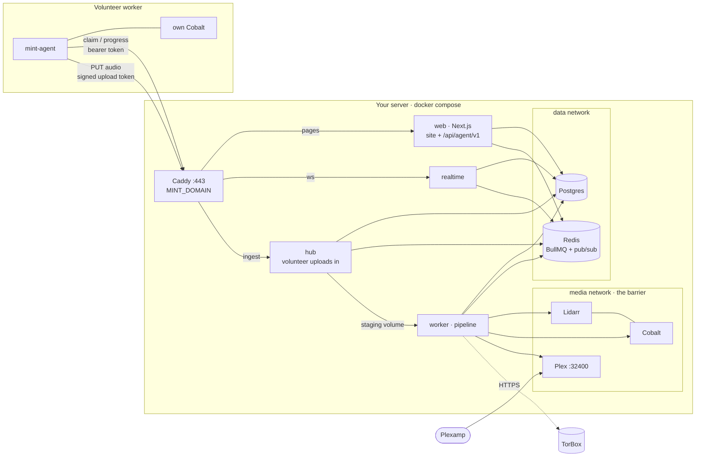
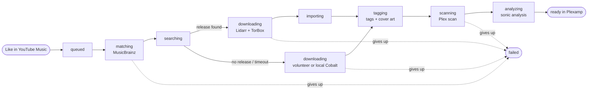
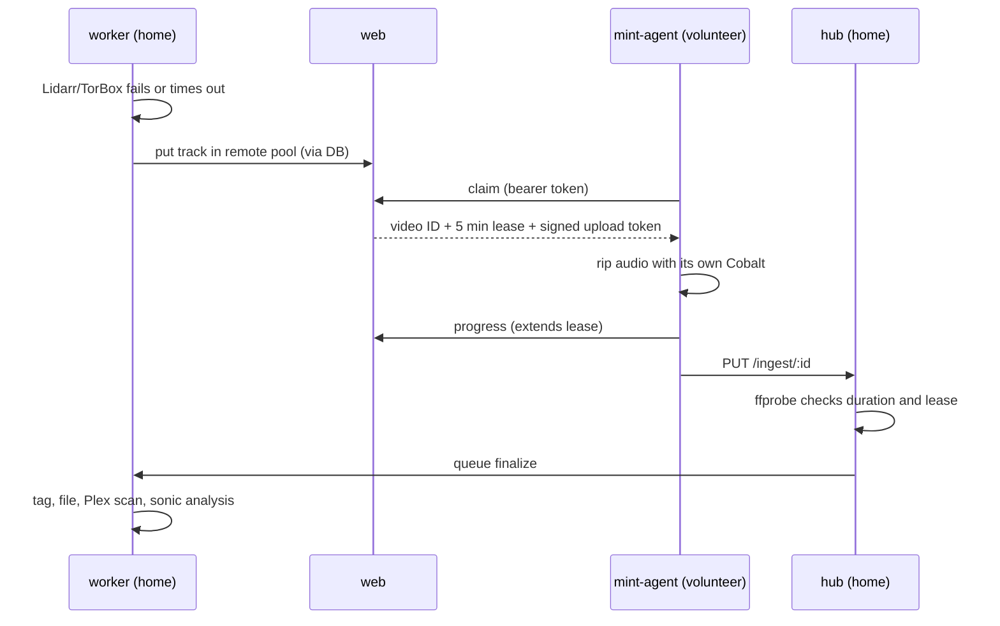

# Mint

Mint lives at **mint.chickenbone.dev**. It's a private music shelf: it syncs each member's YouTube Music likes and playlists, downloads the songs to the host, and serves them through Plex and Plexamp.

- **Public site.** A hero wall built from real cover art in the library, live stats, a live pipeline board (downloading → importing → sonic scan), a searchable library that links each song out to YouTube Music, and a request‑access form. The site never streams audio; listening happens in Plexamp.
- **Member dashboard.** A Spotify‑style app with liked songs, playlists, the library, per‑track job progress, sync settings, and an admin area for approving people.
- **Pipeline.** Lidarr and TorBox are tried first; a self‑hosted Cobalt rip is the fallback. Files are tagged and moved into the shared library, Plex scans them, sonic analysis runs, and per‑user Plex playlists are created.

<p align="center">
  
</p>

| | |
| --- | --- |
|  |  |
| **Public stats.** Library size, sources, sonic coverage and the newest arrivals, updated live. | **Member home.** What's still on its way, with live per‑track progress. |
|  |  |
| **Liked songs.** Synced from YouTube Music, mirrored into a Plex playlist. | **Jobs.** Every song in flight: matching, downloading, importing, Plex scan, sonic analysis. |
|  |  |
| **Admin.** Approve requests, see what still needs setting up, and watch every service and queue. | **Workers.** Lend a machine to the pipeline with one token. |

<p align="center">
  
  &nbsp;
  
  &nbsp;
  
</p>

## NAS setup: copy, paste, deploy

**UGREEN NAS OS, Portainer, or another Docker project editor:** open [`docker-compose.nas.yml`](docker-compose.nas.yml), copy the **entire file**, and paste it into a new Compose project named `mint`. No terminal, `.env`, Git checkout, build, or extra config files.

1. **Edit the settings at the top.** Set `MINT_DOMAIN` to your own hostname, such as `mint.example.com`. Get a fresh `PLEX_CLAIM` from https://plex.tv/claim immediately before deploying; it expires in four minutes. If image downloads take too long, get another token and recreate Plex from the NAS UI. Leave Google and TorBox keys blank until you need them.
2. **Deploy the project.** Point that hostname's DNS at your public IP and forward TCP ports 80 and 443 to the NAS. Caddy obtains an HTTPS certificate automatically. Keep DNS proxying off if your provider limits upload sizes.
3. **Open the `init` container's logs** in the NAS Docker UI. They show the generated admin login. Keep these logs private. `init` finishing successfully is normal, not a failed container.
4. **Open `https://<your-hostname>` and sign in.** Admin lists any remaining setup steps. Add Google credentials to the same settings block and redeploy to enable YouTube Music linking.

Passwords, keys, database, music and Plex configuration persist in Docker-managed volumes. Do not delete the project's volumes when updating. Use the NAS UI to pull newer images and recreate the project. Keep using the same project name.

**HTTPS is required for production login.** If NAS services already occupy 80/443, move them or configure your existing HTTPS reverse proxy; changing port numbers alone does not make certificate issuance work. For a LAN-only installation, use a hostname ending in `.local` with local DNS pointing at the NAS; Caddy uses a local certificate authority, whose root certificate in `caddy_data` must be trusted on your devices.

The NAS file uses standard Compose service definitions, YAML anchors and named volumes, without optional env-file syntax, inline `configs`, or override tags. It requires a Compose implementation that supports health checks and `service_completed_successfully`. Its configuration is validated, but it has not been run on a physical UGREEN NAS.

**Optional Lidarr indexers:** the default port is loopback-only. Without SSH, temporarily change Lidarr's port mapping to `<NAS-LAN-IP>:8686:8686` in the editor, configure authentication and indexers from your LAN, then restore the original mapping. Never forward 8686 on your router. This is unnecessary for Cobalt-only downloads.

### Command-line setup

Prefer a terminal and a `.env`? Use `docker-compose.yml` (Compose 2.24 or newer). It runs the same services and supports more environment overrides.

```bash
mkdir mint && cd mint
curl -fsSLO https://raw.githubusercontent.com/ChickenBone/mint/main/docker-compose.yml
PLEX_CLAIM=claim-xxxxxxxx MINT_DOMAIN=mint.example.com docker compose up -d
docker compose logs init        # prints the site URL and the admin login
```

1. **Get a Plex claim token** at https://plex.tv/claim right before `up`. It expires after 4 minutes and is only needed the first time.
2. **`MINT_DOMAIN`** is your domain pointing at this machine, with ports 80 and 443 open. Caddy gets the HTTPS certificate on its own. Do not leave the example hostname unchanged; production sessions require HTTPS.
3. **Sign in** with the login from `docker compose logs init` (lost it? `docker compose run --rm init`).
4. **Open Admin.** A *To finish setup* box lists whatever is still missing, in plain words. Usually that's:
   - **Google sign‑in** so members can link YouTube Music → [Google](#google-youtube-music-linking)
   - **TorBox + a Lidarr indexer** for full releases. Optional: without them, Mint rips YouTube audio with Cobalt → [Lidarr + TorBox](#lidarr--torbox)

   Put the values in a `.env` next to `docker-compose.yml` (all keys are listed in [`.env.example`](.env.example)), then run `docker compose up -d` again.
5. **Share the Plex library** with each member you approve. Their likes show up in Plexamp.

The worker wires the rest itself on every start: it reads Plex's token once Plex is claimed, creates the Music library at `/music`, reads Lidarr's API key, and adds Lidarr's root folder and TorBox download client. Share the Plex library with each member you approve.

**Updating:** `docker compose pull && docker compose up -d`. To make that automatic, see [CI/CD](#cicd).

> While the repository is private, downloads require GitHub authentication. For a terminal-free installation by other users, make the repository and all four Mint GHCR packages public first. Repository visibility does not automatically change existing package visibility. See [Publishing safely](#publishing-safely).

### Optional: the website on Vercel

You don't need this; the compose stack serves the site itself. Use it if you'd rather have Vercel's edge serve the public pages. Vercel can't reach your Postgres and Redis, so they move to managed services, and the home server keeps everything else.

1. Create a [Neon](https://neon.tech) Postgres database and an [Upstash](https://upstash.com) Redis database on a fixed‑price plan, because BullMQ polls constantly.
2. On the server, add to `.env` (use `;` instead of `:` in `COMPOSE_FILE` on Windows):

   ```bash
   COMPOSE_FILE=docker-compose.yml:docker-compose.vercel.yml
   MINT_DOMAIN=mint.example.com
   DATABASE_URL=postgres://...neon.tech/mint?sslmode=require    # Neon direct URL
   REDIS_URL=rediss://...upstash.io:6379
   ```

   Download [`docker-compose.vercel.yml`](docker-compose.vercel.yml) next to the main file and run `docker compose up -d`. Caddy now answers only `ws.mint.example.com` (live updates) and `hub.mint.example.com` (volunteer uploads). Point both at this machine with DNS only; Cloudflare's proxy caps uploads at 100 MB.
3. Import the repository into Vercel. Set **Root Directory** to `apps/web` and leave "Include files outside the root directory" on. Add the variables from [`apps/web/.env.vercel.example`](apps/web/.env.vercel.example), using Neon's *pooled* URL. Print the shared secrets with `docker compose run --rm init vercel`. `NEXT_PUBLIC_*` values are baked in at build time, so redeploy after changing them.
4. Add `mint.example.com` as a domain in Vercel.

## Architecture

Everything runs from one compose file on your server. Volunteer workers are optional extra machines.

- **Your server** runs the website, the WebSocket gateway, the upload hub, Postgres, Redis, and the media side: Plex, Lidarr, Cobalt and the pipeline.
- **Volunteer workers** are anyone's machine running one Docker image. They rip YouTube audio with their own Cobalt and upload the file to your hub.
- **Vercel (optional)** can host the website instead. Postgres and Redis then move to Neon and Upstash, and Caddy serves only `ws.` and `hub.` subdomains.



| Package | Role |
| --- | --- |
| `apps/web` | Next.js 16: landing, browse, auth, dashboard, server actions, worker registration, and the agent API (`/api/agent/v1/*`) |
| `apps/realtime` | WebSocket gateway. Relays Redis pub/sub to public, per‑user and admin channels. Browsers authenticate with a signed 60‑second ticket from `/api/realtime/ticket` |
| `apps/worker` | Two entry points. `index.js` runs the pipeline: YouTube sync → match (MusicBrainz) → acquire (Lidarr+TorBox / volunteer pool / local Cobalt) → finalize (tag, embed artwork, move) → Plex scan → sonic watch → playlists. `hub.js` takes volunteer uploads and validates them with ffprobe |
| `apps/agent` | The volunteer worker (`ghcr.io/chickenbone/mint-agent`) |
| `packages/core` | Drizzle schema and migrations, env, crypto, the agent protocol, event bus, queue names, stats |

**How a like becomes a file.** Every track moves through the same stages, and each change is published over the WebSocket, so the public board and the member dashboard update live.



Cover art comes from the Cover Art Archive when the song matched a MusicBrainz release, and from the YouTube thumbnail otherwise. It's embedded in the file and saved as `cover.jpg` for Plex. The website shows the same remote image, so the home server never serves media to the public.

**The barrier.** Only the `worker` joins the `media` network, where Lidarr, Cobalt and Plex live. Cobalt and Plex's API have no route from the internet except Plex's own port, and Lidarr is bound to `127.0.0.1:8686`. The website never talks to the media side directly: it reads and writes the database and sends work through Redis queues, the same way whether it runs in compose or on Vercel. The hub has no Plex, Lidarr or TorBox credentials. It accepts a file only for a track whose lease the uploading worker currently holds, then checks it with ffprobe before the worker touches it.

**How a volunteer job flows.**



1. Lidarr/TorBox fails or times out.
2. If a volunteer worker is online (`REMOTE_DOWNLOADS=auto`), the track goes into the remote pool. Otherwise the home server rips it with its own Cobalt.
3. An agent claims the track. Claims use `FOR UPDATE SKIP LOCKED` and give a five‑minute lease that progress reports extend.
4. The agent rips the audio and uploads it to `/ingest/:id` on the hub.
5. The hub verifies the upload, releases the lease and queues `finalize`. The rest is the normal pipeline.
6. Expired leases go back to the pool. A track nobody takes within `REMOTE_WAIT_MINUTES` is ripped locally.

**Privacy.** Public events show which tracks are moving through the pipeline, never who liked them. Workers only receive a YouTube video ID, title and artist. Google refresh tokens are encrypted at rest with AES‑256‑GCM (`ENCRYPTION_KEY`). Worker tokens are stored as SHA‑256 hashes.

## Setup details

### What runs where

| Service | Reachable from | Notes |
| --- | --- | --- |
| `caddy` | internet, :80/:443 | HTTPS for `MINT_DOMAIN`. `/ws` → realtime, `/ingest` → hub, everything else → web |
| `web`, `realtime`, `hub` | Caddy only | `edge` + `data` networks |
| `worker` | nothing | Pipeline. The only service on both `data` and `media` |
| `postgres`, `redis` | `data` network | No published ports |
| `lidarr` | `127.0.0.1:8686` | Reach it from another machine with `ssh -L 8686:127.0.0.1:8686 host` |
| `cobalt` | `media` network | Never exposed |
| `plex` | :32400 | For Plexamp. Turn on Remote Access in Plex |
| `init` | — | Runs once per `up`: generates secrets in the `secrets` volume and fixes folder ownership |

In the NAS file, music lives in the Docker `music` volume. In the command-line file it lands in `./data/music` (`MUSIC_PATH`). Files are owned by UID:GID 1000 by default. Secrets live in the `secrets` volume. Existing generated secrets are preserved across restarts; editing an encryption key or database password is not a rotation procedure. Do not delete the secrets volume independently of the database.

### Google (YouTube Music linking)

1. In Google Cloud, create a project and enable **YouTube Data API v3**.
2. Set up the OAuth consent screen with the scope `https://www.googleapis.com/auth/youtube.readonly`. While the app is in *Testing*, add each member's Google account as a test user (maximum 100). Otherwise, submit the app for verification.
3. Create a **Web application** OAuth client with the redirect URI `https://<MINT_DOMAIN>/api/oauth/google/callback`. Google allows plain http only for `localhost`, so linking needs HTTPS or a browser on the server itself.
4. Set `GOOGLE_CLIENT_ID` and `GOOGLE_CLIENT_SECRET` in the NAS file's settings block, or in `.env` for the command-line stack.

Liked songs come from the YouTube "Liked videos" playlist, filtered to music. Members turn individual playlists on or off.

### Lidarr + TorBox

Set `TORBOX_API_KEY` in the compose settings or `.env`. On its next start, the worker turns Lidarr on (`LIDARR_ENABLED=auto`), adds the `/music` root folder and a **Torrent Blackhole** download client. The one manual step is **indexers**: open Lidarr (`http://localhost:8686` on the server, through an SSH tunnel, or the temporary LAN binding described in [NAS setup](#nas-setup-copy-paste-deploy)) → Settings → Indexers, and add them directly or through Prowlarr.

The worker sends each blackhole torrent or magnet to TorBox, polls it, and downloads the finished files into the watch folder for Lidarr to import. If nothing is grabbed within `LIDARR_GRAB_TIMEOUT_MINUTES`, the track falls back to Cobalt. `LIDARR_ENABLED=false` means Cobalt only. `true` keeps Lidarr on without TorBox, if you've given it your own download client.

### Cobalt

Cobalt runs internally only. If YouTube starts answering "sign in to confirm you're not a bot", export YouTube cookies to `cobalt-cookies.json` (see the [cobalt docs](https://github.com/imputnet/cobalt/blob/main/docs/run-an-instance.md)). Then uncomment the cookie volume and `COOKIE_PATH` under `cobalt` in `docker-compose.yml`. `COBALT_API_KEY` is only needed if you turn on Cobalt's API‑key auth.

### Plex

- **Claiming.** `PLEX_CLAIM` signs the server into your Plex account on its first start. If you missed the 4‑minute window, open `http://<server>:32400/web` from the same network and claim it there.
- **Library.** The worker reads the token from Plex's `Preferences.xml` and creates a **Music** library at `/music`. To use your own token or library, set `PLEX_TOKEN` and `PLEX_MUSIC_SECTION_ID` instead.
- **Sonic analysis** needs Plex Pass. Turn it on under Settings → Library.
- **Remote Access** on port 32400 lets members use Plexamp away from home.
- **Sharing.** Share the library with each approved member from Plex settings; this is manual. Their liked songs then appear in Plexamp as the playlist `Mint · Name · Liked`.

### Troubleshooting

- `docker compose ps` should show every service `running` (healthy) and `init` exited with code 0.
- `docker compose logs worker` prints the same setup notes as the Admin page.
- **Port 80 or 443 already in use:** set `HTTP_PORT`/`HTTPS_PORT` in `.env`. HTTPS certificates need the real 80/443, so put another proxy in front, or free the ports.
- **Login does not persist:** use HTTPS, not an HTTP IP address. Production session cookies are always Secure. Check that `MINT_DOMAIN` matches the hostname in your browser.

### Publishing safely

The local publication audit found no embedded credentials in tracked files or reachable Git history, including a redacted Gitleaks scan. This is a point-in-time check, not a guarantee that every vulnerability is absent.

- Git author/committer metadata contains the maintainer's personal email address. Publishing exposes it. Decide whether that is acceptable before changing visibility; rewriting history requires a separate, coordinated migration.
- Never commit `.env`, a filled-in NAS settings block, exported cookies, logs, database backups, or Docker volume contents. The committed screenshots use fictional demo data and generated cover art.
- Production dependency auditing and Git-history secret scanning run in CI. Development-tool dependency advisories may still need upstream fixes; do not expose development servers to the internet.
- After making the repository public, visit each package's **Package settings → Change visibility → Public**: `mint-web`, `mint-worker`, `mint-realtime`, and `mint-agent`. Verify unauthenticated pulls before advertising the setup as ready for other users.
- Use downloads only for content you are authorized to acquire and share.

## Volunteer workers

Anyone with an approved account can lend a machine to rip YouTube audio. The machine needs Docker and outbound HTTPS only, with no open ports and no access to your server. Each account can register up to 5 workers.

1. Go to **Dashboard → Workers → Register a worker**. Copy the token; it is shown once.
2. Run it:

   ```bash
   mkdir mint-worker && cd mint-worker
   curl -o docker-compose.yml https://mint.chickenbone.dev/worker.yml
   echo "MINT_WORKER_TOKEN=mint_wk_..." > .env
   docker compose up -d
   ```

3. The worker appears online within a minute. Admins approve new workers in **Admin → Workers**, unless `WORKER_AUTO_APPROVE=true`. Owners can revoke their own workers at any time, and revoking releases any job the worker held.

The image is `ghcr.io/chickenbone/mint-agent`. It bundles nothing but Node, and runs read‑only with all capabilities dropped. The compose file pairs it with a private Cobalt container. Tuning: `AGENT_CONCURRENCY` (1–4, default 2).

> GHCR packages from a private repository are private. After the first release, open the **mint-agent** package on GitHub → *Package settings* → *Change visibility* → **Public** so volunteers can pull it.

## Development

```bash
npm ci
docker compose -f docker-compose.dev.yml up -d        # Postgres + Redis
cp .env.development.example .env                       # fill ENCRYPTION_KEY
npm run db:migrate
npm run dev:worker & npm run dev:hub & npm run dev:realtime & npm run dev:web
# a volunteer agent against your dev stack:
MINT_URL=http://localhost:3000 MINT_WORKER_TOKEN=mint_wk_... COBALT_URL=http://localhost:9000 npm run dev:agent
```

Checks: `npm run typecheck`, `npm run lint`, `npm test`, `npm run build`.

## CI/CD

- **`ci.yml`** runs on every push and PR: typecheck, lint, test and build.
- **`release.yml`** runs on `main` and `v*` tags. It builds `ghcr.io/chickenbone/mint-{web,worker,realtime,agent}` for amd64 and arm64, with provenance and an SBOM.
- **Auto‑deploy (optional).** Set the repository variable `DEPLOY_ENABLED=true` (and optionally `DEPLOY_PATH`), plus these secrets:
  - `DEPLOY_HOST`
  - `DEPLOY_USER`
  - `DEPLOY_SSH_KEY`
  - `DEPLOY_KNOWN_HOSTS` (from `ssh-keyscan host`)

  The job then runs `docker compose pull && up -d` over SSH.
- If the packages are private, run `docker login ghcr.io` on the host with a PAT that has `read:packages`.

## Notes

- **No audio on the website.** The public site shows titles, artists and cover art, and links out to YouTube Music. Audio only leaves the server through Plex, to the members you share the library with. Plex sonic analysis drives the "Sonic analysis" lane on the board, and Plexamp's Sonic Radio and Sweet Fades.
- **Upgrading from a version with previews.** Migration `0002_drop_previews` moves any track stuck in the old `previewing` stage to `scanning` and drops the preview columns. The `previews` Docker volume is no longer used; remove it with `docker volume rm mint_previews`.
- **Unverified integrations.** Some assumptions about external APIs are untested against live instances: Lidarr's `?mbId=` and `?foreignAlbumId=` lookups, and Plex's `musicAnalysisVersion` as the "sonic done" marker. Check the worker logs on first run.
- **Upgrading from the split Vercel setup.** `deploy/Caddyfile` and the `CADDYFILE`, `selfhost-web` and `local-db` options are gone; Caddy's config now lives inside the compose files. To keep the site on Vercel, add `COMPOSE_FILE=docker-compose.yml:docker-compose.vercel.yml` and `MINT_DOMAIN=mint.chickenbone.dev` to your existing `.env`, then run `docker compose up -d`. Your existing `ENCRYPTION_KEY`, `MINT_SIGNING_SECRET`, `DATABASE_URL` and `REDIS_URL` keep winning over generated values.
