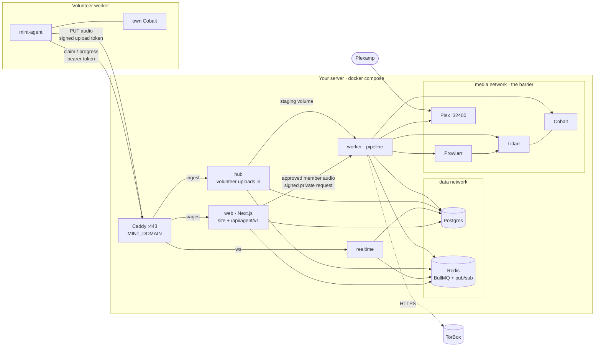
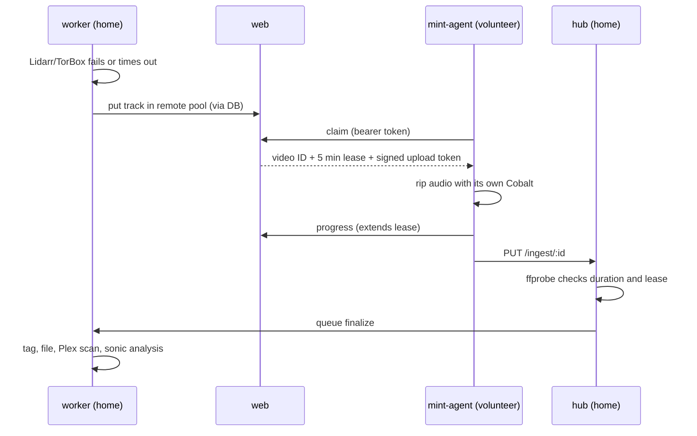

# Mint

Mint lives at **mint.chickenbone.dev**. It's a private music shelf: it syncs each member's YouTube Music likes and playlists, downloads songs to the host, and streams them through Mint while keeping Plex as the library server.

- **Public site.** A hero wall built from real cover art in the library, live stats, a live pipeline board (downloading → importing → sonic scan), a searchable library that links each song out to YouTube Music, and a request‑access form. Public visitors cannot stream audio.
- **Member listening.** Approved members use **Music** inside Mint, with Mint-owned browsing and uninterrupted playback across the dashboard. Plex stays the private library server; external Plex clients remain optional.
- **Member dashboard.** A Spotify‑style app with liked songs, playlists, the library, per‑track job progress, sync settings, and an admin area for approving people.
- **Pipeline.** Lidarr and TorBox are tried first; a self‑hosted Cobalt rip is the fallback. Files are tagged and moved into the shared library, Plex scans them, sonic analysis runs, and per‑user Plex playlists are created.

<p align="center">
  
</p>

| | |
| --- | --- |
|  |  |
| **Public stats.** Library size, sources, sonic coverage and the newest arrivals, updated live. | **Member home.** What's still on its way, with live per‑track progress. |
|  |  |
| **Liked songs.** Synced from YouTube Music, mirrored into a Plex playlist. | **Jobs.** Every song in flight: matching, downloading, importing, Plex scan, sonic analysis. |
|  |  |
| **Admin.** Approve requests, see what still needs setting up, and watch every service and queue. | **Workers.** Lend a machine to the pipeline with one token. |

<p align="center">
  
  &nbsp;
  
  &nbsp;
  
</p>

## NAS setup: copy, paste, deploy

**UGREEN NAS OS, Portainer, or another Docker project editor:** open [`docker-compose.nas.yml`](docker-compose.nas.yml), copy the **entire file**, and paste it into a new Compose project named `mint`. No terminal, `.env`, Git checkout, build, or extra config files.

1. **Create a remotely managed Cloudflare Tunnel** in Cloudflare's dashboard under Networking → Tunnels (or Zero Trust → Networks → Connectors). Choose Cloudflared and name it `mint`. Copy the connector token from the install command: the `eyJ...` value after `--token`, not a Cloudflare API token. Keep it private.
2. **Add a published application/public hostname route** on that tunnel. Hostname: your Mint domain. Service type: **HTTP**. Service URL: **`caddy:80`**. Leave **HTTP Host Header** unset; an existing Mint-domain override is also fine. The private Caddy listener accepts the tunnel's internal hostname and forwards the configured Mint hostname to the web app. If an A/CNAME already exists for Mint, remove only that conflicting record first; let Cloudflare create the tunnel DNS record. Do not remove the NAS's own DNS record. A DNS-only CNAME pointing at your WAN IP is not a tunnel.
3. **Edit the settings at the top and deploy.** Set `MINT_DOMAIN` to that hostname and `TUNNEL_TOKEN` to the connector token. Pull the images first, then get a fresh `PLEX_CLAIM` from https://plex.tv/claim and recreate Plex immediately; it expires in four minutes. Leave the claim blank for an existing Plex server, and leave Google/TorBox keys blank until needed.
4. **Open the `init` container's logs** in the NAS Docker UI for the generated admin login. Keep these logs private. `init` finishing successfully is normal. Open `https://<your-hostname>` and sign in; Admin lists remaining setup steps.

**No public ports or certificate setup for Mint.** The bundled `cloudflared` connector makes outbound connections over TCP 7844 using HTTP/2, which avoids dependence on outbound UDP. Cloudflare handles public HTTPS; Caddy only serves HTTP inside the Docker network. No router port forwarding, WAN loopback, host networking, or Let's Encrypt is involved. Never set `MINT_DOMAIN` to a NAS IP or downgrade login cookies. Plex Remote Access is separate and may still need its own forwarding.

**UGREEN project folders:** select a permanent storage path when creating the project in Docker → Project. The NAS template uses `./data/...` bind folders relative to that path: database, secrets, staging, music and service configs appear there in File Manager. The [UGREEN Docker guide](https://ai.ugreen.com/blogs/knowledge/docker-docker-compose-ugreen-nas) documents this behavior; do not assume every NAS uses `/volume1` or a fixed `/docker` path. Keep the project path unchanged during updates. Give the Docker application access to the folder. Mint runs as UID/GID 1000 and `init` owns only Mint's music, staging, blackhole and secret folders; it never changes permissions on your existing music.

**Migrating an existing named-volume installation:** do this before replacing the old compose text. Switching mounts does not move data automatically.

1. Back up your Mint data and **stop all containers in the existing Mint project**, including Postgres and Redis, without deleting anything.
2. In a temporary Compose Project, paste [`docker-compose.nas-migrate.yml`](docker-compose.nas-migrate.yml). Set `DESTINATION` to the real absolute path of the final Mint project's `data` folder (from UGOS File Manager). Check the old volume names at the bottom against Docker's volume list; `mint_...` applies only if the original project was named `mint`.
3. Deploy the copy project and inspect its logs. It must exit successfully after copying all ten stores. It preserves file ownership, refuses non-empty destinations and never deletes the originals. Missing old volumes cause a failure instead of silently making blank volumes. Do not resume Mint against a partial copy; inspect and back up any partially copied destination before retrying.
4. Replace the original Mint project's entire compose text with the NAS template, restore your settings and tunnel token, and pull/recreate its containers using the **same storage path**. Verify your original login works before retiring the old volumes. Do not remove the original project with a delete-data option.

For subsequent folder-based updates, simply pull/recreate the containers while preserving the project folders. No new Plex claim is needed for an already claimed server. The old `CADDY_SCHEME` and `ACME_RETRY_DIRECTORY` settings are no longer used in the NAS template. An existing DNS updater must not overwrite Mint's tunnel record.

**Existing cloudflared installation:** this template includes a separate Mint connector. Configure its route as `http://caddy:80`, not `localhost` or the NAS IP. Do not reuse a tunnel token across other connectors unless all of them can reach the same configured service; Cloudflare may send requests to any connected replica.

Passwords, keys, database, music and Plex configuration persist in the project's bind folders. Do not delete the project storage directory when updating.

**Troubleshooting:** `cloudflared` logs should show registered tunnel connections and the dashboard should show the connector healthy. Authentication errors usually mean a missing/incorrect tunnel token. A Cloudflare 502 usually means an unreachable/wrong origin: use `http://caddy:80`. A completely blank page with HTTP 200 and zero response bytes can occur with older hostname-filtered Caddy configurations when the tunnel sends a different Host header. Update the project's compose text and recreate Caddy; pulling images alone does not update this inline configuration. No migration rerun or data deletion is needed. If connections time out, allow outbound TCP 7844 from Docker. Mint's Caddy has no host ports, so it does not conflict with NAS management on 80/443.

**Plex says `Could not resolve host: plex.tv`:** claiming failed at DNS, before the claim token could be validated. The NAS template sets `PLEX_DNS` to Cloudflare/Google resolvers for the Plex container only, keeping Docker service discovery and bridge isolation. Replace these with reachable resolvers if your network blocks public DNS (`[]` restores Docker defaults). Recreate Plex with a new claim after images are pulled; preserve its config folder. This does not prove the claim succeeded: check that the DNS error disappears and Plex reports the server claimed. `libusb_init failed` is explicitly marked ignorable by the image and is not the claim failure.

**Check migration paths, not just folder existence:** Postgres running `initdb` and `CREATE DATABASE`, or Redis creating its first AOF files, indicates new stores were initialized at the mounted paths. If you expected old accounts/data, stop the project, preserve both old volumes and new folders, and compare the migration `DESTINATION` with the project's actual `./data` location in UGOS. Do not copy a database while it is running, rerun the copy into non-empty destinations, or delete secrets independently of the database.

**Limits:** Cloudflare's upload-size limits still apply to volunteer audio uploads; the app's 200 MB limit does not override the provider's limit. WebSockets pass through the tunnel. Do not route Plex streaming through this Mint tunnel. For direct hosting or LAN-only HTTPS without Cloudflare, use the command-line compose stack below instead.

The NAS file uses standard Compose service definitions, YAML anchors and bind folders, without optional env-file syntax, inline `configs`, or override tags. It requires a Compose implementation that supports health checks and `service_completed_successfully`. Its configuration is validated, but it has not been run on a physical UGREEN NAS.

**Automatic indexers:** with `TORBOX_API_KEY` set, Mint configures bundled Prowlarr and Lidarr automatically. See [Lidarr + TorBox](#lidarr--torbox) for the public sources and optional Usenet indexer account. To manage additional indexers, Prowlarr is loopback-only on port 9696: use `ssh -L 9696:127.0.0.1:9696 <NAS-user>@<NAS-IP>`. Without SSH, temporarily bind `<NAS-LAN-IP>:9696:9696`, configure Prowlarr authentication before adding credentials, then restore loopback. Never forward 9696 or Lidarr's 8686 on your router.

**Updating for automatic setup:** replace the project's compose text with the current template, restoring **all** your settings and custom mounts (especially existing music), then pull/recreate the project at its unchanged storage path. Pulling only the worker image does not add the new Prowlarr service. Its `./data/prowlarr` folder is new and initializes automatically; do not rerun the ten-volume migration or delete any old data. Keep your existing Plex token, section ID and read-only settings; no new claim is needed.

### Use an existing Plex music library read-only

The NAS template already runs a local `worker` and Cobalt; there is no volunteer token to create. **Workers → Built-in NAS worker** reports its heartbeat. Volunteer counts refer only to optional remote machines. `REMOTE_DOWNLOADS: "never"` keeps acquisition on this NAS by default.

For an existing Plex server, change these settings at the top of the NAS template:

```yaml
PLEX_URL: &plex-url "http://10.0.0.176:32400"
PLEX_TOKEN: &plex-token "YOUR_EXISTING_PLEX_TOKEN"
PLEX_MUSIC_SECTION_ID: &plex-section "YOUR_MUSIC_SECTION_ID"
PLEX_READ_ONLY: &plex-read-only "true"
INDEX_EXISTING_LIBRARY: &index-existing "true"
EXISTING_MUSIC_FOLDER: &existing-music-folder "/volume1/YOUR_REAL_MUSIC_FOLDER"
EXISTING_PLEX_MUSIC_DIR: &existing-plex-dir "/music"
```

Use your real NAS folder path. `EXISTING_PLEX_MUSIC_DIR` is the matching path **inside your existing Plex installation**, not necessarily the NAS path. For example, `/volume1/Music` mounted as `/media/music` in Plex means `EXISTING_MUSIC_FOLDER: "/volume1/Music"` and `EXISTING_PLEX_MUSIC_DIR: "/media/music"`. [Find your Plex token](https://support.plex.tv/articles/204059436); the section ID is the music library's ID, not an artist or track ID. Mint validates that it identifies a music section. Keep the token out of Git and screenshots.

The worker mounts the original folder at `/existing-music:ro`. Only the worker gets the Plex token or that mount; the public app and upload hub do not. In read-only mode Mint makes no Plex claim, library creation, scan, analysis or playlist writes. You can remove the bundled `plex` service when using your existing server; otherwise it uses NAS port **32401** to avoid conflicting with an existing Plex on 32400. Mint-owned downloads remain in `./data/music`.

**Indexing:** Mint reads Plex's music section in pages of 200, checks mapped files exist, and upserts into its existing keyset-paginated library. It runs on startup and every six hours. Admin shows indexing progress and mapping/access errors. Missing or out-of-root entries are counted as skipped. YouTube sync waits for a successful index, avoiding a flood of duplicate downloads during first startup. Imported songs without YouTube IDs have no fabricated YouTube link or cover. Rescans do not delete your files or overwrite an accepted Mint upgrade; removed entries are not automatically purged from Mint.

**Reuse and upgrades:** likes/playlists match originals by normalized artist/title, compatible album metadata and duration within five seconds. Lossless/unknown originals are reused. Ambiguous same-name editions are held as failed jobs for review rather than silently downloading a duplicate. Requests queued before indexing are reconciled too, preserving likes and playlist positions. Each confidently matched lossy original gets one upgrade attempt when first requested by YouTube sync. Lidarr must have a **lossless-only quality profile** and indexers; if no lossless profile/source exists, Mint keeps the original and does not fall back to YouTube. Candidate downloads must be inspected: ffprobe checks both original and candidate codec and duration before accepting an upgrade. A codec check cannot prove a FLAC wasn't transcoded from a lossy source; Mint does not claim spectral authenticity.

Accepted upgrades are saved separately under `./data/music/upgrades/<track-id>/`; originals are never replaced, deleted, retagged or handed to Lidarr. Failed/rejected upgrade attempts keep the original available. Existing Plex remains read-only, so separately downloaded files do not appear there until **you** add Mint's download folder to Plex; playlist mirroring is disabled in this mode. Turn off indexing to use the bundled Plex pipeline as before.

### Command-line setup

Prefer a terminal and a `.env`? Use `docker-compose.yml` (Compose 2.24 or newer). It runs the same services and supports more environment overrides.

```bash
mkdir mint && cd mint
curl -fsSLO https://raw.githubusercontent.com/ChickenBone/mint/main/docker-compose.yml
PLEX_CLAIM=claim-xxxxxxxx MINT_DOMAIN=mint.example.com docker compose up -d
docker compose logs init        # prints the site URL and the admin login
```

1. **Get a Plex claim token** at https://plex.tv/claim right before `up`. It expires after 4 minutes and is only needed the first time.
2. **`MINT_DOMAIN`** is your domain pointing at this machine, with ports 80 and 443 open. Caddy gets the HTTPS certificate on its own. Do not leave the example hostname unchanged; production sessions require HTTPS.
3. **Sign in** with the login from `docker compose logs init` (lost it? `docker compose run --rm init`).
4. **Open Admin.** A *To finish setup* box lists whatever is still missing, in plain words. Usually that's:
   - **Google sign‑in** so members can link YouTube Music → [Google](#google-youtube-music-linking)
   - **TorBox** for full releases with automatic public indexers. Optional: without it, Mint rips YouTube audio with Cobalt → [Lidarr + TorBox](#lidarr--torbox)

   Put the values in a `.env` next to `docker-compose.yml` (all keys are listed in [`.env.example`](.env.example)), then run `docker compose up -d` again.
5. **Optionally share the Plex library** with approved members who also want an external Plex client. Mint's own player uses the approved Mint account and needs no separate Plex invitation.

The worker wires the rest itself on every start: it reads Plex's token once Plex is claimed, creates the Music library at `/music`, reads the private Lidarr/Prowlarr API keys, and configures the root folder, TorBox torrent/Usenet download clients and public indexers. Existing read-only Plex is only indexed, never claimed or modified. Share the Plex library with each member you approve.

**Updating:** `docker compose pull && docker compose up -d`. To make that automatic, see [CI/CD](#cicd).

> While the repository is private, downloads require GitHub authentication. For a terminal-free installation by other users, make the repository and all four Mint GHCR packages public first. Repository visibility does not automatically change existing package visibility. See [Publishing safely](#publishing-safely).

### Optional: the website on Vercel

You don't need this; the compose stack serves the site itself. Use it if you'd rather have Vercel's edge serve the public pages. Vercel can't reach your Postgres and Redis, so they move to managed services, and the home server keeps everything else.

1. Create a [Neon](https://neon.tech) Postgres database and an [Upstash](https://upstash.com) Redis database on a fixed‑price plan, because BullMQ polls constantly.
2. On the server, add to `.env` (use `;` instead of `:` in `COMPOSE_FILE` on Windows):

   ```bash
   COMPOSE_FILE=docker-compose.yml:docker-compose.vercel.yml
   MINT_DOMAIN=mint.example.com
   DATABASE_URL=postgres://...neon.tech/mint?sslmode=require    # Neon direct URL
   REDIS_URL=rediss://...upstash.io:6379
   ```

   Download [`docker-compose.vercel.yml`](docker-compose.vercel.yml) next to the main file and run `docker compose up -d`. Caddy now answers only `ws.mint.example.com` (live updates) and `hub.mint.example.com` (volunteer uploads). Point both at this machine with DNS only; Cloudflare's proxy caps uploads at 100 MB.
3. Import the repository into Vercel. Set **Root Directory** to `apps/web` and leave "Include files outside the root directory" on. Add the variables from [`apps/web/.env.vercel.example`](apps/web/.env.vercel.example), using Neon's *pooled* URL. Print the shared secrets with `docker compose run --rm init vercel`. `NEXT_PUBLIC_*` values are baked in at build time, so redeploy after changing them.
4. Add `mint.example.com` as a domain in Vercel.

## Architecture

### Native browser listening (V3.1)

`/app/music` is entirely Mint-owned: native browsing, search, artist/album views, queues and a persistent two-deck HTMLAudio/Web Audio player. There is no embedded Plexamp, vendor download, patched module loader, synthetic Plex server/cloud API or iframe. `/listen` remains a redirect to Music; obsolete `/listen/engine`, asset and compatibility routes are removed. Plex remains the private library server and existing acquisition/indexing integrations are preserved.

Approved members can browse songs/albums/artists/imported playlists, search, listen to liked songs and use persistent playback/seek/volume, queue, shuffle and repeat controls. Catalog pages contain at most 100 entries; playback loads the complete selected collection in pages of 500, not just the visible page. Right-click or use a song's options button for play now/next, add to queue, artist shuffle and album/artist navigation. Menus support arrow keys, Escape and keyboard invocation.

**Now playing:** click the bottom player's artwork or song title to open Mint's own artwork-led song view, not Plexamp's native player. Desktop places listening tools alongside the cover; phones keep seek, shuffle, repeat and transport pinned below the scrollable content. Up next, Lyrics and Sound share one keyboard-accessible tab set. Switching tools preserves sound drafts and loaded lyrics within the view, and sound changes confirm only after the engine acknowledges them. Queue actions operate on upcoming songs without interrupting the current one. Back or Escape returns to the page you opened it from; the engine, audio and queue stay mounted. Entrances respect reduced-motion preferences.

**Play and shuffle collections:** Music and Library have explicit Play/Shuffle actions. A filtered search plays all matching tracks, not just the loaded page; liked songs and imported playlists use member-private collections. Shuffle visits each queued item once before wrapping in repeat-all mode; previous follows the shuffled order. Queue entries have distinct identities even when a song is added twice. Upcoming songs can be moved earlier/later or removed, and clearing upcoming never stops the current song.

**Audio settings:** the sliders button in the player opens Mint's real Web Audio processing: ten EQ bands, preamp, presets, optional dynamic-range compression and 0–12 second equal-power crossfades between two audio decks. Apply sound saves settings per member/device; Reset / bypass disables processing and transitions. EQ boosts reserve headroom, with another 3.1 dB reserved when transitions are enabled; compression is not a guaranteed brick-wall limiter. Crossfades are off by default to preserve continuous albums, skip repeat-one, and cancel on pause, seek, queue edits, skip or access revocation. These are authored browser transitions, **not Plexamp's proprietary Sweet Fades or loudness/content-aware native DSP**. Browser/device resampling and codec limits still apply.

**Feature availability:** Mint's EQ, compression, fixed crossfades, lyrics and artist shuffle are independent implementations and do not require Plex Pass. Browsers without Web Audio do not see processing controls; ordinary playback and volume remain usable. Artist shuffle is not presented as sonic similarity. Independent sonic analysis, content-aware Smart Fades, discovery, native/collaborative playlists, device handoff and offline downloads are approved V3 work, not implemented features of this foundation. See the approved scope in PRODUCT.md.

**Lyrics:** the microphone button looks up the current track on [LRCLIB](https://lrclib.net), without an API key. Synced lines highlight with playback and seek when tapped; plain lyrics, instrumental, no-match and retry states are distinct. Scrolling pauses automatic following. Only opening Lyrics requests a lookup; no library-wide scan runs. The provider receives title, artist, album and duration, never audio, credentials or filesystem paths. Lookups are cached in server Redis, deduplicated and rate-limited; provider `Retry-After` is honored.

**Android Chrome installation:** serve Mint over HTTPS, then use **Install Mint** when Chrome offers it, or Chrome's menu → **Install app / Add to Home screen**. Settings and Audio settings include installation guidance. The manifest has 192/512 PNG and maskable icons, standalone launch to Music, and library/likes shortcuts. The service worker is deliberately network-only: it does not cache private HTML, API responses, lyrics or audio. Offline navigation explains that the server connection is required. This is a PWA, not a native Android player; background playback remains subject to Android/Chrome power policies. Chrome installability is checked in a regular browser profile, but physical Android installation and background behavior need device verification.

Queues, position and sound preferences are saved in member-namespaced local browser storage. Reloading restores the queue **paused**, never autoplaying. Storage failures are reported without stopping ordinary playback. This is local restoration, not cross-device synchronization. Client-side member navigation preserves the same audio elements. Refreshing, closing the tab or signing out stops audio. Public pages never mount the engine, and all pages prohibit framing. The optional **Open Plexamp** Settings link launches a separate installed app, not an embedded dependency.

The web service has no music mount or media-network access. It proxies `/api/player/audio/...` to `PLAYBACK_WORKER_URL=http://worker:8080` over the private data network, using a short-lived, session/track-bound signed claim. The worker rechecks approval and session expiry, confines reads to its configured library folders and supports HTTP byte ranges. Access is checked during streaming and every 15 seconds in the player, including when audio is already buffered. Native catalog/session/media responses are private and non-cacheable. **Do not publish worker port 8080**, and never put a Plex administrator token in browser settings.

MP3, FLAC, M4A/MP4, AAC, Ogg/Opus and WAV are currently served without transcoding; actual codec support depends on the browser. Large queues retain their complete in-memory sequence while exposing at most 1,000 entries around the current song to the UI; the queue reports when only part of upcoming is visible. No proprietary DSP or entitlement bypass is involved.

Docker and local builds no longer fetch Plexamp or require `player:prepare`, `tar` or `bzip2`. For local development use Node 22+, set `PLAYBACK_WORKER_URL=http://localhost:8080`, and start web/worker normally. Browser playback targets the all-in-one Docker deployment. Vercel cannot reach `http://worker:8080`; private gateway connectivity and streaming limits must be validated separately. Do not expose the worker publicly as a workaround.

**Updating an existing NAS project:** wait for the GitHub **Release** workflow for the desired commit to finish successfully before pulling `latest`. In UGREEN Docker → Project, keep your current Compose settings, storage path and custom mounts. Add `PLAYBACK_WORKER_URL: http://worker:8080` under the `web` service's `environment`, then pull the new `mint-web` and `mint-worker` images and recreate both containers. A restart alone does not use a newly pulled image. Alternatively, with the current Compose file, run `docker compose pull web worker && docker compose up -d --no-deps web worker`. Do not delete project data, rerun the old volume migration or obtain a new Plex claim.

The V3 native foundation needs the rebuilt web image and a V2.6-or-newer playback worker, but no new environment keys, database migrations or Plex claims. V2 browser queues/preferences are intentionally not imported from the removed vendor adapter. Keep Redis available for lyrics cache/rate limits. Hard-refresh Mint after recreating the containers; installed PWAs should be closed and reopened. Do not configure a CDN rule to cache `/app`, `/api`, `/listen` or `/sw.js`.

Keep `/volume2/MusicVol2` mounted read-only at `/existing-music` in the worker. If Plex also sees those originals at `/existing-music`, keep `EXISTING_PLEX_MUSIC_DIR=/existing-music`, your existing Plex token, section ID `2` and read-only configuration. After recreating services, sign in, open **Music**, and play an indexed, downloaded track. Open Jobs or Settings and confirm playback continues. Missing tracks still need successful indexing; this update does not repair mismatched mounts. Logged-out `/app/music` redirects to login; native catalog/session/media requests require approved membership.

Everything runs from one compose file on your server. Volunteer workers are optional extra machines. The NAS template adds `cloudflared → Caddy` as the public entry path, with no published Caddy ports. The diagram below shows the direct-hosting command-line stack; both use the same application and media boundaries.

- **Your server** runs the website, the WebSocket gateway, the upload hub, Postgres, Redis, and the media side: Plex, Lidarr, Cobalt and the pipeline.
- **Volunteer workers** are anyone's machine running one Docker image. They rip YouTube audio with their own Cobalt and upload the file to your hub.
- **Vercel (optional)** can host the website instead. Postgres and Redis then move to Neon and Upstash, and Caddy serves only `ws.` and `hub.` subdomains.



| Package | Role |
| --- | --- |
| `apps/web` | Next.js 16: landing, browse, auth, dashboard, server actions, worker registration, and the agent API (`/api/agent/v1/*`) |
| `apps/realtime` | WebSocket gateway. Relays Redis pub/sub to public, per‑user and admin channels. Browsers authenticate with a signed 60‑second ticket from `/api/realtime/ticket` |
| `apps/worker` | Two entry points. `index.js` runs the pipeline: YouTube sync → match (MusicBrainz) → acquire (Lidarr+TorBox / volunteer pool / local Cobalt) → finalize (tag, embed artwork, move) → Plex scan → sonic watch → playlists. `hub.js` takes volunteer uploads and validates them with ffprobe |
| `apps/agent` | The volunteer worker (`ghcr.io/chickenbone/mint-agent`) |
| `packages/core` | Drizzle schema and migrations, env, crypto, the agent protocol, event bus, queue names, stats |

**How a like becomes a file.** Every track moves through the same stages, and each change is published over the WebSocket, so the public board and the member dashboard update live.


Cover art comes from the Cover Art Archive when the song matched a MusicBrainz release, and from the YouTube thumbnail otherwise. It's embedded in the file and saved as `cover.jpg` for Plex. The website shows the same remote image, so the home server never serves media to the public.

**The barrier.** Only the pipeline `worker` connects the data and media tiers; Lidarr, Prowlarr, Cobalt and Plex live on `media`. Cobalt and Plex's API have no route from the internet except Plex's own port; Lidarr/Prowlarr management ports are bound to loopback. The website never talks to the media side directly: it reads and writes the database and sends work through Redis queues, the same way whether it runs in compose or on Vercel. The hub has no Plex, Lidarr, Prowlarr, Usenet indexer or TorBox credentials. It accepts a file only for a track whose lease the uploading worker currently holds, then checks it with ffprobe before the worker touches it.

**How a volunteer job flows.**



1. Lidarr/TorBox fails or times out.
2. If a volunteer worker is online (`REMOTE_DOWNLOADS=auto`), the track goes into the remote pool. Otherwise the home server rips it with its own Cobalt.
3. An agent claims the track. Claims use `FOR UPDATE SKIP LOCKED` and give a five‑minute lease that progress reports extend.
4. The agent rips the audio and uploads it to `/ingest/:id` on the hub.
5. The hub verifies the upload, releases the lease and queues `finalize`. The rest is the normal pipeline.
6. Expired leases go back to the pool. A track nobody takes within `REMOTE_WAIT_MINUTES` is ripped locally.

**Privacy.** Public events show which tracks are moving through the pipeline, never who liked them. Workers only receive a YouTube video ID, title and artist. Google refresh tokens are encrypted at rest with AES‑256‑GCM (`ENCRYPTION_KEY`). Worker tokens are stored as SHA‑256 hashes.

## Setup details

### What runs where

| Service | Reachable from | Notes |
| --- | --- | --- |
| `caddy` | internet, :80/:443 | HTTPS for `MINT_DOMAIN`. `/ws` → realtime, `/ingest` → hub, everything else → web |
| `web`, `realtime`, `hub` | Caddy only | `edge` + `data` networks |
| `worker` | nothing | Pipeline. The only service on both `data` and `media` |
| `postgres`, `redis` | `data` network | No published ports |
| `lidarr` | `127.0.0.1:8686` | Reach it from another machine with `ssh -L 8686:127.0.0.1:8686 host` |
| `cobalt` | `media` network | Never exposed |
| `plex` | :32400 | For Plexamp. Turn on Remote Access in Plex |
| `init` | — | Runs once per `up`: generates secrets in the `secrets` volume and fixes folder ownership |

The table's public Caddy ports apply to `docker-compose.yml`. In the NAS template, Caddy is reachable only by the bundled tunnel connector on `edge`; the connector publishes no ports and has no data/media network membership or integration credentials.

In the NAS file, music lives in the project's `./data/music` bind folder, while secrets live in `./data/secrets`. In the command-line file it lands in `./data/music` (`MUSIC_PATH`) and secrets use a named volume. Files are owned by UID:GID 1000 by default. Existing generated secrets are preserved across restarts; editing an encryption key or database password is not a rotation procedure. Never discard secrets independently of the database.

### Google (YouTube Music linking)

1. In Google Cloud, create a project and enable **YouTube Data API v3**.
2. Set up the OAuth consent screen with the scope `https://www.googleapis.com/auth/youtube.readonly`. While the app is in *Testing*, add each member's Google account as a test user (maximum 100). Otherwise, submit the app for verification.
3. Create a **Web application** OAuth client with the redirect URI `https://<MINT_DOMAIN>/api/oauth/google/callback`. Google allows plain http only for `localhost`, so linking needs HTTPS or a browser on the server itself.
4. Set `GOOGLE_CLIENT_ID` and `GOOGLE_CLIENT_SECRET` in the NAS file's settings block, or in `.env` for the command-line stack.

Liked songs come from the YouTube "Liked videos" playlist, filtered to music. Members turn individual playlists on or off.

### Lidarr + TorBox

Set `TORBOX_API_KEY` in the compose settings or `.env`. The worker turns Lidarr on (`LIDARR_ENABLED=auto`), adds `/music`, and creates **Torrent Blackhole** and **Usenet Blackhole** clients. Both Compose deployments include private, persistent Prowlarr. Mint discovers its API key from the read-only config mount and links it to Lidarr using **add-only** synchronization, restricted to music categories. Existing indexers, application links, disabled sources and download clients are preserved.

**Public torrent sources:** Mint attempts Internet Archive, The Pirate Bay, LimeTorrents and 1337x, without accounts. This is a bounded starter list, not a promise of availability or lossless coverage. Prowlarr tests before saving; blocked sites, CAPTCHA/Cloudflare challenges, DNS failures and empty music feeds are reported in Admin setup notes or private Prowlarr/Lidarr events. Missing sources retry every ten minutes; unavailable Prowlarr retries in one minute. Mint does not install CAPTCHA bypass services or force-save broken sources. The Pirate Bay's default feed is narrowed to Audio. Use only material you are entitled to download.

**Usenet:** TorBox Pro supplies the download/provider side, not an independent searchable music catalog. Set `USENET_INDEXER_URL` to a music-capable Newznab base URL and `USENET_INDEXER_API_KEY` to that indexer's key; Mint registers it in Prowlarr and syncs it to Lidarr. These are **not** your TorBox key or NNTP credentials. API access, free-tier limits, signup and any indexer fees depend on that service. For nonstandard endpoints, use `USENET_INDEXER_API_PATH` (default `/api`) in the worker environment. You can also add multiple account-based sources in Prowlarr. Newly provisioned settings are preserved afterward: change saved account keys/settings in Prowlarr, not by expecting Mint to overwrite them on restart.

NZBIndex was tested as a no-signup alternative, but its Prowlarr definition exposes no music categories and its categorized feed returns no results, so it cannot reliably sync to Lidarr. Mint deliberately does not install it as a working automatic source. A TorBox Pro account alone therefore does not make Usenet searching ready; Admin states when the separate indexer is missing.

The bridge submits `.torrent`/`.magnet` files from `/blackhole/torrents` and `.nzb` files from `/blackhole/nzbs` to the corresponding TorBox APIs, reports remote/local progress, and streams completed releases into separate torrent (`/blackhole/downloads`) and Usenet (`/blackhole/usenet-downloads`) watch folders so Lidarr cannot import one release through both clients. Queue IDs distinguish torrent and Usenet downloads even when TorBox reuses numeric IDs. Original files remain read-only; existing-library upgrades still require a verified lossy-to-lossless improvement and are stored separately.

Set `AUTO_CONFIGURE_INDEXERS=false` to leave all indexer setup to you. `PROWLARR_PUBLIC_INDEXERS` selects the comma-separated public definitions to attempt (empty disables seeding). Already saved sources are never removed by changing this list. Prowlarr is unnecessary for Cobalt-only use. If nothing is grabbed within `LIDARR_GRAB_TIMEOUT_MINUTES`, unmatched new tracks fall back to Cobalt; existing-library upgrades never do. `LIDARR_ENABLED=false` means Cobalt only. `true` keeps Lidarr on without TorBox, if you've given it your own download client.

### Cobalt

Cobalt runs internally only. If YouTube starts answering "sign in to confirm you're not a bot", export YouTube cookies to `cobalt-cookies.json` (see the [cobalt docs](https://github.com/imputnet/cobalt/blob/main/docs/run-an-instance.md)). Then uncomment the cookie volume and `COOKIE_PATH` under `cobalt` in `docker-compose.yml`. `COBALT_API_KEY` is only needed if you turn on Cobalt's API‑key auth.

### Album artwork

Missing covers, including already indexed Plex-library tracks, are filled automatically from **MusicBrainz + Cover Art Archive**. No account or API key is required; images load directly from the public archive, never through Plex or a NAS artwork endpoint. Matching requires the album title and artist to agree, rather than assigning the first search result. Unmatched albums keep the existing placeholder.

The worker starts a bounded backfill on boot and every 30 seconds, processing up to ten albums per pass. All tracks with matching artist/album share the result, and open pages receive artwork through the existing WebSocket updates. Large libraries fill progressively, respecting MusicBrainz's one-request-per-second limit. Results are cached for 30 days; absent covers for one day. Upstream failures are logged and retried on later passes, not cached as missing covers. Saved artwork is preserved, and original audio files/tags remain untouched. Tracks without album metadata cannot be matched this way.

### Plex

- **Claiming.** `PLEX_CLAIM` signs the bundled server into your Plex account on first start; it expires in four minutes, including time spent pulling images. Bundled NAS Plex is at `http://<server>:32401/web` (command-line stack: 32400). If it stays unclaimed, preserve its config folder and recreate only Plex with a fresh claim. A missing token in `Preferences.xml` may mean an expired claim or a wrong config mount; permission errors are reported separately. Existing read-only Plex needs its explicit token and section ID, not a new claim.
- **Library.** The worker reads the token from Plex's `Preferences.xml` and creates a **Music** library at `/music`. To use your own token or library, set `PLEX_TOKEN` and `PLEX_MUSIC_SECTION_ID` instead.
- **Sonic analysis** needs Plex Pass. Turn it on under Settings → Library.
- **Remote Access** on port 32400 lets members use Plexamp away from home.
- **Sharing.** Share the library with each approved member from Plex settings; this is manual. Their liked songs then appear in Plexamp as the playlist `Mint · Name · Liked`.

### Troubleshooting

- `docker compose ps` should show every service `running` (healthy) and `init` exited with code 0.
- `docker compose logs worker` prints the same setup notes as the Admin page.
- **Port 80 or 443 already in use:** set `HTTP_PORT`/`HTTPS_PORT` in `.env`. HTTPS certificates need the real 80/443, so put another proxy in front, or free the ports.
- **Login does not persist:** use HTTPS, not an HTTP IP address. Production session cookies are always Secure. Check that `MINT_DOMAIN` matches the hostname in your browser.

### Publishing safely

The local publication audit found no embedded credentials in tracked files or reachable Git history, including a redacted Gitleaks scan. This is a point-in-time check, not a guarantee that every vulnerability is absent.

- Git author/committer metadata contains the maintainer's personal email address. Publishing exposes it. Decide whether that is acceptable before changing visibility; rewriting history requires a separate, coordinated migration.
- Never commit `.env`, a filled-in NAS settings block, exported cookies, logs, database backups, or Docker volume contents. The committed screenshots use fictional demo data and generated cover art.
- Production dependency auditing and Git-history secret scanning run in CI. Development-tool dependency advisories may still need upstream fixes; do not expose development servers to the internet.
- After making the repository public, visit each package's **Package settings → Change visibility → Public**: `mint-web`, `mint-worker`, `mint-realtime`, and `mint-agent`. Verify unauthenticated pulls before advertising the setup as ready for other users.
- Use downloads only for content you are authorized to acquire and share.

## Volunteer workers

Anyone with an approved account can lend a machine to rip YouTube audio. The machine needs Docker and outbound HTTPS only, with no open ports and no access to your server. Each account can register up to 5 workers.

1. Go to **Dashboard → Workers → Register a worker**. Copy the token; it is shown once.
2. Run it:

   ```bash
   mkdir mint-worker && cd mint-worker
   curl -o docker-compose.yml https://mint.chickenbone.dev/worker.yml
   echo "MINT_WORKER_TOKEN=mint_wk_..." > .env
   docker compose up -d
   ```

3. The worker appears online within a minute. Admins approve new workers in **Admin → Workers**, unless `WORKER_AUTO_APPROVE=true`. Owners can revoke their own workers at any time, and revoking releases any job the worker held.

The image is `ghcr.io/chickenbone/mint-agent`. It bundles nothing but Node, and runs read‑only with all capabilities dropped. The compose file pairs it with a private Cobalt container. Tuning: `AGENT_CONCURRENCY` (1–4, default 2).

> GHCR packages from a private repository are private. After the first release, open the **mint-agent** package on GitHub → *Package settings* → *Change visibility* → **Public** so volunteers can pull it.

## Development

```bash
npm ci
docker compose -f docker-compose.dev.yml up -d        # Postgres + Redis
cp .env.development.example .env                       # fill ENCRYPTION_KEY
npm run db:migrate
npm run dev:worker & npm run dev:hub & npm run dev:realtime & npm run dev:web
# a volunteer agent against your dev stack:
MINT_URL=http://localhost:3000 MINT_WORKER_TOKEN=mint_wk_... COBALT_URL=http://localhost:9000 npm run dev:agent
```

Checks: `npm run typecheck`, `npm run lint`, `npm test`, `npm run build`.

## CI/CD

- **`ci.yml`** runs on every push and PR: typecheck, lint, test and build.
- **`release.yml`** runs on `main` and `v*` tags. It builds `ghcr.io/chickenbone/mint-{web,worker,realtime,agent}` for amd64 and arm64, with provenance and an SBOM.
- **Auto‑deploy (optional).** Set the repository variable `DEPLOY_ENABLED=true` (and optionally `DEPLOY_PATH`), plus these secrets:
  - `DEPLOY_HOST`
  - `DEPLOY_USER`
  - `DEPLOY_SSH_KEY`
  - `DEPLOY_KNOWN_HOSTS` (from `ssh-keyscan host`)

  The job then runs `docker compose pull && up -d` over SSH.
- If the packages are private, run `docker login ghcr.io` on the host with a PAT that has `read:packages`.

## Notes

- **No public audio.** Public pages remain browse-only. Approved members can listen through Mint's authenticated browser gateway or through a separately shared Plex library. Plex sonic analysis drives the "Sonic analysis" lane and Mint's read-only sonic recommendations; proprietary native Plexamp DSP/Sweet Fades remain separate.
- **Upgrading from a version with previews.** Migration `0002_drop_previews` moves any track stuck in the old `previewing` stage to `scanning` and drops the preview columns. The `previews` Docker volume is no longer used; remove it with `docker volume rm mint_previews`.
- **Unverified integrations.** Some assumptions about external APIs are untested against live instances: Lidarr's `?mbId=` and `?foreignAlbumId=` lookups, and Plex's `musicAnalysisVersion` as the "sonic done" marker. Check the worker logs on first run.
- **Upgrading from the split Vercel setup.** `deploy/Caddyfile` and the `CADDYFILE`, `selfhost-web` and `local-db` options are gone; Caddy's config now lives inside the compose files. To keep the site on Vercel, add `COMPOSE_FILE=docker-compose.yml:docker-compose.vercel.yml` and `MINT_DOMAIN=mint.chickenbone.dev` to your existing `.env`, then run `docker compose up -d`. Your existing `ENCRYPTION_KEY`, `MINT_SIGNING_SECRET`, `DATABASE_URL` and `REDIS_URL` keep winning over generated values.
