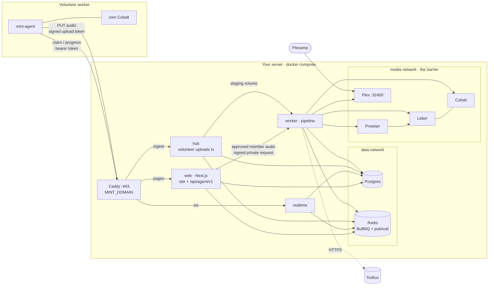
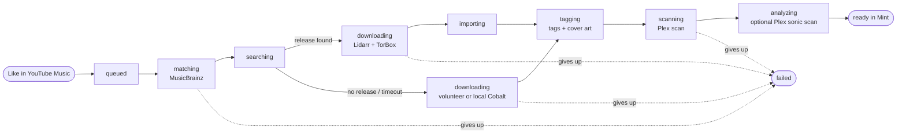
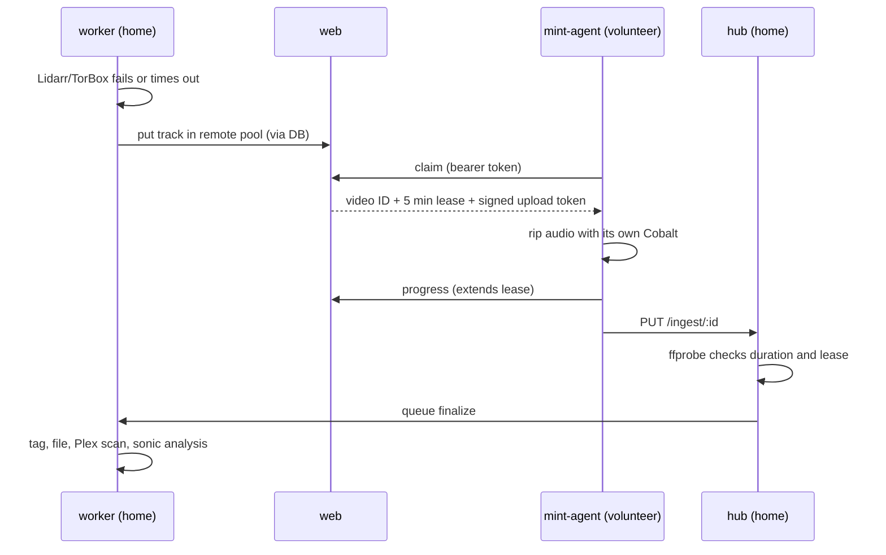

# Mint self-hosting guide

[Back to the README](../README.md)

Run your own Mint instance on your domain. This guide covers installation, an existing Plex library, optional music sources, remote workers, backups and upgrades. You do not need an account on the maintainer's Mint instance.

Start with **one** deployment below. Both run the complete application; Vercel and remote workers are optional advanced configurations, not prerequisites.

## On this page

- [NAS or Portainer installation](#nas-setup-copy-paste-deploy)
- [Connect an existing Plex library](#use-an-existing-plex-music-library-read-only)
- [Linux server and command-line installation](#command-line-setup)
- [Vercel limitations and setup](#optional-the-website-on-vercel)
- [Expo app and Android updates](#expo-consumer-app-and-browser-sign-in)
- [Listening features](#native-browser-listening)
- [Chart discovery](#chart-discovery)
- [Upgrades and backups](#updating-an-existing-installation)
- [Private analysis workers](#optional-separate-analysis-machine)
- [Architecture](#architecture)
- [Services, integrations and troubleshooting](#setup-details)
- [Optional MusicBrainz metadata mirror](#optional-musicbrainz-metadata-mirror)
- [Optional standalone catalog connection](catalog-connection.md)
- [Optional standalone chart metadata API](#optional-standalone-chart-metadata-api)
- [Volunteer download workers](#volunteer-workers)
- [Development](#development) and [CI/CD](#cicd)

Use only music you are authorized to download, store and share. Public pages reveal library metadata and artwork, but never provide public audio streaming.

### Expo consumer app and browser sign-in

The [Expo setup guide](mobile.md) covers iOS/Android and the secondary web app.
This is the primary consumer client; Next.js still serves browser listening,
approved-account APIs and admin-only management. Native Search's data-backed
Browse all and read-only chart categories require a backend version containing
the native browse/chart facade; updating JavaScript alone cannot add server routes.
Keep provider and acquisition credentials on the backend, not in Expo settings.
For Expo web hosted on another origin, set server-side `NATIVE_WEB_ORIGINS`
to the browser page's exact origin(s), including scheme and port, with no
paths or wildcards. The CLI stack reads it from `.env`; NAS users set it in
the template's top settings block; Vercel users add it to the web project's
environment. Restart/recreate or redeploy the web server after changing it.
Local Expo commonly uses `http://localhost:8081`; `127.0.0.1` is a different
origin. Native iOS/Android do not need browser CORS. Existing web-cookie
authentication and CSRF protections remain unchanged.

Android APKs and OTA application updates now use [EAS Build and EAS Update](android-builds.md).
Mint's backend still serves native account and music APIs; Expo does not receive
your music library or backend credentials. No OTA server/container/volume is
required. When upgrading from the previous self-hosted OTA setup, remove
`ota-storage-init`, the web OTA mount and dependency, and `OTA_STORAGE_DIR`,
`OTA_PUBLISH_TOKEN_SHA256`, `OTA_SIGNING_CERTIFICATES` and `OTA_MAX_STORAGE_BYTES`
from your private Compose configuration. Stop including the retired
`docker-compose.updates.yml` overlay. Preserve the old update folder/volume
until backed up; do not delete data to perform this migration. Keep
`NATIVE_WEB_ORIGINS` and every existing database, media and secrets mount.
Install the new EAS-enabled APK; an old APK cannot change its embedded update
server through an EAS update.

## NAS setup: copy, paste, deploy

**UGREEN NAS OS, Portainer, or another Docker project editor:** open [`docker-compose.nas.yml`](../docker-compose.nas.yml), copy the **entire file**, and paste it into a new Compose project named `mint`. No terminal, `.env`, Git checkout, build, or extra config files.

1. **Create a remotely managed Cloudflare Tunnel** in Cloudflare's dashboard under Networking → Tunnels (or Zero Trust → Networks → Connectors). Choose Cloudflared and name it `mint`. Copy the connector token from the install command: the `eyJ...` value after `--token`, not a Cloudflare API token. Keep it private.
2. **Add a published application/public hostname route** on that tunnel. Hostname: your Mint domain. Service type: **HTTP**. Service URL: **`caddy:80`**. Leave **HTTP Host Header** unset; an existing Mint-domain override is also fine. The private Caddy listener accepts the tunnel's internal hostname and forwards the configured Mint hostname to the web app. If an A/CNAME already exists for Mint, remove only that conflicting record first; let Cloudflare create the tunnel DNS record. Do not remove the NAS's own DNS record. A DNS-only CNAME pointing at your WAN IP is not a tunnel.
3. **Edit the settings at the top and deploy.** Set `MINT_DOMAIN` to that hostname and `TUNNEL_TOKEN` to the connector token. Pull the images first, then get a fresh `PLEX_CLAIM` from https://plex.tv/claim and recreate Plex immediately; it expires in four minutes. Leave the claim blank for an existing Plex server, and leave Google/TorBox keys blank until needed.
4. **Open the `init` container's logs** in the NAS Docker UI for the generated admin login. Keep these logs private. `init` finishing successfully is normal. Open `https://<your-hostname>` and sign in; Admin lists remaining setup steps.

**No public ports or certificate setup for Mint.** The bundled `cloudflared` connector makes outbound connections over TCP 7844 using HTTP/2, which avoids dependence on outbound UDP. Cloudflare handles public HTTPS; Caddy only serves HTTP inside the Docker network. No router port forwarding, WAN loopback, host networking, or Let's Encrypt is involved. Never set `MINT_DOMAIN` to a NAS IP or downgrade login cookies. Plex Remote Access is separate and may still need its own forwarding.

**UGREEN project folders:** select a permanent storage path when creating the project in Docker → Project. The NAS template uses `./data/...` bind folders relative to that path: database, secrets, staging, music and service configs appear there in File Manager. The [UGREEN Docker guide](https://ai.ugreen.com/blogs/knowledge/docker-docker-compose-ugreen-nas) documents this behavior; do not assume every NAS uses `/volume1` or a fixed `/docker` path. Keep the project path unchanged during updates. Give the Docker application access to the folder. Mint runs as UID/GID 1000 and `init` owns only Mint's music, staging, blackhole and secret folders; it never changes permissions on your existing music.

**Migrating an existing named-volume installation:** do this before replacing the old compose text. Switching mounts does not move data automatically.

1. Back up your Mint data and **stop all containers in the existing Mint project**, including Postgres and Redis, without deleting anything.
2. In a temporary Compose Project, paste [`docker-compose.nas-migrate.yml`](../docker-compose.nas-migrate.yml). Set `DESTINATION` to the real absolute path of the final Mint project's `data` folder (from UGOS File Manager). Check the old volume names at the bottom against Docker's volume list; `mint_...` applies only if the original project was named `mint`.
3. Deploy the copy project and inspect its logs. It must exit successfully after copying all ten stores. It preserves file ownership, refuses non-empty destinations and never deletes the originals. Missing old volumes cause a failure instead of silently making blank volumes. Do not resume Mint against a partial copy; inspect and back up any partially copied destination before retrying.
4. Replace the original Mint project's entire compose text with the NAS template, restore your settings and tunnel token, and pull/recreate its containers using the **same storage path**. Verify your original login works before retiring the old volumes. Do not remove the original project with a delete-data option.

For subsequent folder-based updates, simply pull/recreate the containers while preserving the project folders. No new Plex claim is needed for an already claimed server. The old `CADDY_SCHEME` and `ACME_RETRY_DIRECTORY` settings are no longer used in the NAS template. An existing DNS updater must not overwrite Mint's tunnel record.

**Existing cloudflared installation:** this template includes a separate Mint connector. Configure its route as `http://caddy:80`, not `localhost` or the NAS IP. Do not reuse a tunnel token across other connectors unless all of them can reach the same configured service; Cloudflare may send requests to any connected replica.

Passwords, keys, database, music and Plex configuration persist in the project's bind folders. Do not delete the project storage directory when updating.

**Troubleshooting:** `cloudflared` logs should show registered tunnel connections and the dashboard should show the connector healthy. Authentication errors usually mean a missing/incorrect tunnel token. A Cloudflare 502 usually means an unreachable/wrong origin: use `http://caddy:80`. A completely blank page with HTTP 200 and zero response bytes can occur with older hostname-filtered Caddy configurations when the tunnel sends a different Host header. Update the project's compose text and recreate Caddy; pulling images alone does not update this inline configuration. No migration rerun or data deletion is needed. If connections time out, allow outbound TCP 7844 from Docker. Mint's Caddy has no host ports, so it does not conflict with NAS management on 80/443.

**Plex says `Could not resolve host: plex.tv`:** claiming failed at DNS, before the claim token could be validated. The NAS template sets `PLEX_DNS` to Cloudflare/Google resolvers for the Plex container only, keeping Docker service discovery and bridge isolation. Replace these with reachable resolvers if your network blocks public DNS (`[]` restores Docker defaults). Recreate Plex with a new claim after images are pulled; preserve its config folder. This does not prove the claim succeeded: check that the DNS error disappears and Plex reports the server claimed. `libusb_init failed` is explicitly marked ignorable by the image and is not the claim failure.

**Check migration paths, not just folder existence:** Postgres running `initdb` and `CREATE DATABASE`, or Redis creating its first AOF files, indicates new stores were initialized at the mounted paths. If you expected old accounts/data, stop the project, preserve both old volumes and new folders, and compare the migration `DESTINATION` with the project's actual `./data` location in UGOS. Do not copy a database while it is running, rerun the copy into non-empty destinations, or delete secrets independently of the database.

**Limits:** Cloudflare's upload-size limits still apply to volunteer audio uploads; the app's 200 MB limit does not override the provider's limit. WebSockets pass through the tunnel. Do not route Plex streaming through this Mint tunnel. For direct hosting or LAN-only HTTPS without Cloudflare, use the command-line compose stack below instead.

The NAS file uses standard Compose service definitions, YAML anchors and bind folders, without optional env-file syntax, inline `configs`, or override tags. It requires a Compose implementation that supports health checks and `service_completed_successfully`. Its configuration is validated, but it has not been run on a physical UGREEN NAS.

**Automatic indexers:** with `TORBOX_API_KEY` set, Mint configures bundled Prowlarr and Lidarr automatically. See [Lidarr + TorBox](#lidarr--torbox) for the public sources and optional Usenet indexer account. To manage additional indexers, Prowlarr is loopback-only on port 9696: use `ssh -L 9696:127.0.0.1:9696 <NAS-user>@<NAS-IP>`. Without SSH, temporarily bind `<NAS-LAN-IP>:9696:9696`, configure Prowlarr authentication before adding credentials, then restore loopback. Never forward 9696 or Lidarr's 8686 on your router.

**Updating for automatic setup:** replace the project's compose text with the current template, restoring **all** your settings and custom mounts (especially existing music), then pull/recreate the project at its unchanged storage path. Pulling only the worker image does not add the new Prowlarr service. Its `./data/prowlarr` folder is new and initializes automatically; do not rerun the ten-volume migration or delete any old data. Keep your existing Plex token, section ID and read-only settings; no new claim is needed.

### Use an existing Plex music library read-only

The NAS template already runs a local `worker` and Cobalt; there is no volunteer token to create. **Workers → Built-in NAS worker** reports its heartbeat. Volunteer counts refer only to optional remote machines. `REMOTE_DOWNLOADS: "never"` keeps acquisition on this NAS by default.

For an existing Plex server, change these settings at the top of the NAS template:

```yaml
PLEX_URL: &plex-url "http://YOUR_PLEX_LAN_IP:32400"
PLEX_TOKEN: &plex-token "YOUR_EXISTING_PLEX_TOKEN"
PLEX_MUSIC_SECTION_ID: &plex-section "YOUR_MUSIC_SECTION_ID"
PLEX_READ_ONLY: &plex-read-only "true"
INDEX_EXISTING_LIBRARY: &index-existing "true"
EXISTING_MUSIC_FOLDER: &existing-music-folder "/volume1/YOUR_REAL_MUSIC_FOLDER"
EXISTING_PLEX_MUSIC_DIR: &existing-plex-dir "/music"
```

Use your real NAS folder path. `EXISTING_PLEX_MUSIC_DIR` is the matching path **inside your existing Plex installation**, not necessarily the NAS path. For example, `/volume1/Music` mounted as `/media/music` in Plex means `EXISTING_MUSIC_FOLDER: "/volume1/Music"` and `EXISTING_PLEX_MUSIC_DIR: "/media/music"`. [Find your Plex token](https://support.plex.tv/articles/204059436); the section ID is the music library's ID, not an artist or track ID. Mint validates that it identifies a music section. Keep the token out of Git and screenshots.

The worker mounts the original folder at `/existing-music:ro`. Only the worker gets the Plex token or that mount; the public app and upload hub do not. In read-only mode Mint makes no Plex claim, library creation, scan, analysis or playlist writes. You can remove the bundled `plex` service when using your existing server; otherwise it uses NAS port **32401** to avoid conflicting with an existing Plex on 32400. Mint-owned downloads remain in `./data/music`.

**Indexing:** Mint reads Plex's music section in pages of 200, checks mapped files exist, and upserts into its existing keyset-paginated library. It runs on startup and every six hours. Admin shows indexing progress and mapping/access errors. Missing or out-of-root entries are counted as skipped. YouTube sync waits for a successful index, avoiding a flood of duplicate downloads during first startup. Imported songs without YouTube IDs have no fabricated YouTube link or cover. Rescans do not delete your files or overwrite an accepted Mint upgrade; removed entries are not automatically purged from Mint.

**Reuse and upgrades:** likes/playlists match originals by normalized artist/title, compatible album metadata and duration within five seconds. Lossless/unknown originals are reused. Ambiguous same-name editions are held as failed jobs for review rather than silently downloading a duplicate. Requests queued before indexing are reconciled too, preserving likes and playlist positions. Each confidently matched lossy original gets one upgrade attempt when first requested by YouTube sync. Lidarr must have a **lossless-only quality profile** and indexers; if no lossless profile/source exists, Mint keeps the original and does not fall back to YouTube. Candidate downloads must be inspected: ffprobe checks both original and candidate codec and duration before accepting an upgrade. A codec check cannot prove a FLAC wasn't transcoded from a lossy source; Mint does not claim spectral authenticity.

Accepted upgrades are saved separately under `./data/music/upgrades/<track-id>/`; originals are never replaced, deleted, retagged or handed to Lidarr. Failed/rejected upgrade attempts keep the original available. Existing Plex remains read-only, so separately downloaded files do not appear there until **you** add Mint's download folder to Plex; playlist mirroring is disabled in this mode. Turn off indexing to use the bundled Plex pipeline as before.

### Command-line setup

Prefer a terminal and a `.env`? Use [`docker-compose.yml`](../docker-compose.yml) (Compose 2.24 or newer). It runs the same services and supports more environment overrides. Configure your domain and inbound ports 80/443 before starting.

```bash
mkdir mint && cd mint
curl -fsSLO https://raw.githubusercontent.com/ChickenBone/mint/main/docker-compose.yml
curl -fsSL -o .env https://raw.githubusercontent.com/ChickenBone/mint/main/.env.example
chmod 600 .env
# Edit .env and set MINT_DOMAIN to your real hostname.
docker compose pull
# Now get a fresh Plex claim and set PLEX_CLAIM in .env.
docker compose up -d
docker compose logs init        # prints the site URL and private admin login
```

1. **Get a Plex claim token** at https://plex.tv/claim after pulling images, right before `up`. It expires after 4 minutes and is only needed the first time. Remove the expired value after the server is claimed; preserve its configuration.
2. **`MINT_DOMAIN`** is your domain pointing at this machine, with ports 80 and 443 open. Caddy gets the HTTPS certificate on its own. Do not leave the example hostname unchanged; production sessions require HTTPS.
3. **Sign in** with the login from `docker compose logs init` (lost it? `docker compose run --rm init`).
4. **Open Admin.** A *To finish setup* box lists whatever is still missing, in plain words. Usually that's:
   - **Google sign‑in** so members can link YouTube Music → [Google](#google-youtube-music-linking)
   - **TorBox** for full releases with automatic public indexers. Optional: without it, Mint rips YouTube audio with Cobalt → [Lidarr + TorBox](#lidarr--torbox)

   Put the values in a `.env` next to `docker-compose.yml` (all keys are listed in [`.env.example`](../.env.example)), then run `docker compose up -d` again.
5. **Optionally share the Plex library** with approved members who also want an external Plex client. Mint's own player uses the approved Mint account and needs no separate Plex invitation.

The worker wires the rest itself on every start: it reads Plex's token once Plex is claimed, creates the Music library at `/music`, reads the private Lidarr/Prowlarr API keys, and configures the root folder, TorBox torrent/Usenet download clients and public indexers when enabled. Existing read-only Plex is only indexed, never claimed or modified. Separate Plex invitations are optional for people using external Plex clients.

**Updating:** back up first, then [update the worker before web](#updating-an-existing-installation). Optional automation is described under [CI/CD](#cicd).

The upstream repository is public. If you deploy a private fork or private GHCR packages, authenticate Docker with `read:packages`; changing repository visibility alone does not change package visibility. See [Publishing safely](#publishing-safely).

#### Existing Plex with the command-line stack

The `.env` file alone does not add a music mount or replace the worker's Compose-level `PLEX_URL`. Before starting, add these values to your private `.env`, using your own paths and music section ID:

```dotenv
PLEX_URL=http://YOUR_PLEX_LAN_IP:32400
PLEX_TOKEN=replace-with-your-existing-token
PLEX_MUSIC_SECTION_ID=replace-with-your-music-section-id
EXISTING_MUSIC_FOLDER=/absolute/host/path/to/music
EXISTING_PLEX_MUSIC_DIR=/path/as/seen/by/plex
```

Save this as `compose.plex.yml` alongside `docker-compose.yml`:

```yaml
services:
  worker:
    environment:
      PLEX_URL: ${PLEX_URL:?set your existing Plex URL}
      PLEX_TOKEN: ${PLEX_TOKEN:?set your existing Plex token}
      PLEX_MUSIC_SECTION_ID: ${PLEX_MUSIC_SECTION_ID:?set your music section ID}
      PLEX_READ_ONLY: "true"
      INDEX_EXISTING_LIBRARY: "true"
      EXISTING_MUSIC_DIR: /existing-music
      EXISTING_PLEX_MUSIC_DIR: ${EXISTING_PLEX_MUSIC_DIR:?set the music path inside Plex}
    volumes:
      - ${EXISTING_MUSIC_FOLDER:?set your host music folder}:/existing-music:ro
  plex:
    profiles: ["bundled-plex"]
```

The profile keeps the bundled Plex container off, avoiding a conflict with your existing server. Leave `PLEX_CLAIM` blank. Start with `docker compose -f docker-compose.yml -f compose.plex.yml up -d`, and use **both files on subsequent pull/update commands**, or set `COMPOSE_FILE=docker-compose.yml:compose.plex.yml` in `.env` on Linux. See the [read-only library section](#use-an-existing-plex-music-library-read-only) for matching, upgrades and indexing behavior.

### Optional: the website on Vercel

**Advanced deployment, not the recommended first installation.** The Compose stack already serves the website. Vercel cannot resolve the private `worker` Docker hostname, so native listening and artwork require separately designed private gateway connectivity and validation of Vercel's streaming limits. The steps below describe the split web/data setup, not a complete native-playback solution. Do not publish worker port 8080 as a workaround.

Vercel also needs reachable PostgreSQL and Redis; the home server keeps the private media services.

1. Create a [Neon](https://neon.tech) Postgres database and an [Upstash](https://upstash.com) Redis database on a fixed‑price plan, because BullMQ polls constantly.
2. On the server, add to `.env` (use `;` instead of `:` in `COMPOSE_FILE` on Windows):

   ```bash
   COMPOSE_FILE=docker-compose.yml:docker-compose.vercel.yml
   MINT_DOMAIN=mint.example.com
   DATABASE_URL=postgres://...neon.tech/mint?sslmode=require    # Neon direct URL
   REDIS_URL=rediss://...upstash.io:6379
   ```

   Download [`docker-compose.vercel.yml`](../docker-compose.vercel.yml) next to the main file and run `docker compose up -d`. Caddy now answers only `ws.mint.example.com` (live updates) and `hub.mint.example.com` (volunteer uploads). Point both at this machine with DNS only; proxied uploads are subject to your provider's plan limits.
3. Import the repository into Vercel. Set **Root Directory** to `apps/web` and leave "Include files outside the root directory" on. Add the variables from [`apps/web/.env.vercel.example`](../apps/web/.env.vercel.example), using Neon's *pooled* URL. Print the shared secrets with `docker compose run --rm init vercel`. `NEXT_PUBLIC_*` values are baked in at build time, so redeploy after changing them.
4. Add `mint.example.com` as a domain in Vercel.

### Optional MusicBrainz metadata mirror

**Optional advanced setup, not part of Mint's default startup.** Mint continues to use
public MusicBrainz unless the pipeline worker's `MUSICBRAINZ_MIRROR_URL` is set.
A real mirror is MusicBrainz's recording/artist/release **metadata database**, not
a free song/audio collection, not complete coverage of every song, and not a cache.
It does not replace Plex: local browsing, availability, file paths and primary
library artwork still use indexed Plex metadata. Existing Plex and original music
remain read-only when configured that way.

Use the maintained [MetaBrainz musicbrainz-docker stack](https://github.com/metabrainz/musicbrainz-docker)
in a **separate project**, with its own PostgreSQL, MusicBrainz server, Solr search,
indexer and Valkey. Mint does not substitute an unverified single-container image,
share its application database with the mirror, download dumps, build search indexes
or enable replication automatically.

#### Capacity, licensing and freshness

The upstream README checked in November 2026 recommends **x86-64, 16 CPU threads,
16 GB RAM and 350 GB disk with indexed search**; without indexed search its estimate
is 2 threads, 4 GB and 100 GB. These are estimates, not caps: reserve additional
space for downloads, imports, indexes, backups and growth. Mint's name-based matching
needs indexed search, so a database-only mirror is insufficient. The upstream stack
builds images from its supplied build contexts; its current PostgreSQL version and
schema are independent of Mint's. Do not assume ARM NAS support or sufficient space.

- [Core catalog dumps](https://musicbrainz.org/doc/MusicBrainz_Database/Download)
  (`mbdump.tar.bz2`) are **CC0**. Derived data (including user tags/ratings),
  edit/editor/statistics and artwork-reference dumps have **CC BY-NC-SA 3.0**
  terms. Preserve applicable attribution and share-alike obligations; do not label
  the whole installation CC0: upstream's default `createdb.sh -fetch` imports
  noncommercial-licensed dumps too, not just the CC0 core. Artwork-reference dumps do not contain cover images,
  and metadata licensing does not license audio or artwork.
- [Live Data Feed](https://musicbrainz.org/doc/Live_Data_Feed) replication packets
  are **CC BY-NC-SA 3.0**. Personal/noncommercial operators can obtain a free
  MetaBrainz account/access token. Commercial use requires reviewing MetaBrainz's
  account/licensing arrangements; do not assume replication is free for any use.
- A dump-only installation is a **snapshot**, not a live mirror. Database
  replication does not itself update Solr. Rebuild indexes on a deliberate schedule
  or evaluate upstream's explicitly experimental live indexing. Upstream's default
  replication cron is daily, not hourly; monitor both replication lag and index age.

#### Explicit provisioning (large download; operator action required)

Mint includes an opt-in, pinned upstream provisioner,
[`deploy/docker/musicbrainz.mjs`](../deploy/docker/musicbrainz.mjs), and the checked
[`docker-compose.musicbrainz.yml`](../docker-compose.musicbrainz.yml) connection
overlay. These manage actual upstream containers, not a metadata proxy/cache.
Requirements: Node.js 22+, Git, Bash, Docker Compose 2.24+ and the capacity/license
review above. Upstream revision is pinned to
`7536deb1d528508d5ec3ee2f710f9c98c764fb01`; upgrading that pin requires reviewing
upstream schema and migration guidance.

Run these **from the Mint checkout**, choosing a new, permanent project-relative
directory (the example under `data` is ignored by Git):

```bash
# Source checkout and Compose configuration only. No image build, dataset fetch or startup.
node deploy/docker/musicbrainz.mjs prepare data/musicbrainz-upstream
node deploy/docker/musicbrainz.mjs config data/musicbrainz-upstream
# Explicit image build; still no metadata database download.
node deploy/docker/musicbrainz.mjs build data/musicbrainz-upstream
# LARGE metadata download/import. Run only after reviewing resources and CC BY-NC-SA terms.
node deploy/docker/musicbrainz.mjs import data/musicbrainz-upstream --accept-large-download-and-license
# Start the imported upstream stack, then explicitly build search indexes.
node deploy/docker/musicbrainz.mjs start data/musicbrainz-upstream
node deploy/docker/musicbrainz.mjs index data/musicbrainz-upstream
```

The provisioner refuses an existing preparation directory, a changed upstream
revision, starting before successful import, and repeating a completed import.
A failed import does not get a success marker: inspect upstream logs and any
partially imported database before retrying. It never deletes or resets data
to repair failures. Do not rerun import as an update mechanism.

Import/indexing may take hours. Upstream's alternative prebuilt indexes
(approximately 60 GB compressed) remain a separate explicit large download.
No import or indexing happens during Mint startup, updates, `prepare`, `config`,
or `start`. The upstream project uses the distinct Compose name `mint-musicbrainz`
and its own named stores. Retain its directory, volumes and replication secrets
through updates and back up deliberately.

The supplied upstream override removes **all** API host ports and attaches only
the MusicBrainz API to the internal `mint_metadata` bridge; its database, Solr and
Valkey remain on its own network. The provisioner creates that bridge if absent
and refuses an existing non-internal bridge. Do **not** enable upstream's
`publishing-all-ports`: its README warns that internal services are unsafe to expose.

Verify lookup **and indexed search** in the imported stack before connecting Mint.
Then use the checked overlay:

```bash
docker compose -f docker-compose.yml -f docker-compose.musicbrainz.yml config --quiet
docker compose -f docker-compose.yml -f docker-compose.musicbrainz.yml up -d worker
```

Use both files on subsequent updates, together with any existing Plex override.
For the NAS template, use `docker-compose.nas.yml` instead of `docker-compose.yml`;
project editors may merge the worker attachment and external-network declaration
from the overlay into their private compose text. Advanced provisioning still
requires the commands above; this is **not** a one-paste NAS installation. Without
Git/Bash/build support, use a separately managed upstream installation instead.
No public service joins `mint_metadata`, and original music mounts remain unchanged.
Never publish mirror internals through Mint's tunnel.

Optionally enable replication **in the upstream directory**, following its README:
   `admin/set-replication-token`, `admin/configure add replication-token`, then
   recreate its services. Run `docker compose exec -T musicbrainz replication.sh`
   to catch up, and explicitly enable `admin/configure add replication-cron` if
   desired. Keep that token only in the upstream project's secrets; Mint never needs
   it. Use `docker compose --project-name mint-musicbrainz` for manual commands in
   that directory so they operate on the provisioned project's existing stores.
   Plan search-index refreshes and upstream schema upgrades separately; do not
   remove the supplied network override when enabling replication.

For a different host, use a trusted private/VPN API endpoint ending in `/ws/2`,
with firewall/TLS appropriate to that connection; `localhost` inside Mint's worker
is not the other host. No username/password, query or fragment is accepted in the
configured API base.

#### Runtime behavior and verification

Only worker `musicBrainzJson` consumers use this setting: recording acquisition,
artist metadata and album-art identity matching. Web missing-music resolution
currently still uses public MusicBrainz; Cover Art Archive, Wikidata, Wikipedia
and ListenBrainz also remain separate public services.

Mirror requests preserve the query and user-agent, allow at most **3 seconds per
attempt** (or the caller's shorter timeout), do not retry and reject redirects.
Transport/HTTP/invalid-JSON or malformed endpoint-response failures log a warning and fall back to the original
public API with its existing timeout/retry settings. The per-worker serialized
1.1-second MusicBrainz throttle remains in place, including public fallback.
There is no guaranteed speedup, global fleet-wide throttle or catalog freshness
check. A valid empty or outdated mirror result is not an outage and does not trigger
public fallback or silently substitute a different recording. A broken mirror can
add up to three seconds before the existing public request budget.
Recording, artist and release-group searches require their expected result arrays
(including valid empty arrays); lookups require entity identity and title/name.
An arbitrary `{}` or malformed entries are not accepted as empty successful searches.

Verify a `/ws/2/artist?query=artist:Queen&fmt=json&limit=1` search and a recording
lookup from the **worker's** network, inspect upstream import/index/replication
logs, then confirm an explicit missing-recording match. With the mirror stopped,
confirm the warning and public fallback; if both services fail, the existing
failure behavior remains. Mint's Compose validation and mocked tests do not prove
an actual database import, NAS connectivity or replication. The pinned upstream
checkout/config and Mint overlay were validated without building upstream images
or importing its database; import, indexed performance and replication remain
operator verification steps. To disable, remove the connection overlay (or clear
`MUSICBRAINZ_MIRROR_URL` in your private compose text) and recreate the worker;
preserve mirror data/backups.

### Optional standalone chart metadata API

The default stacks keep chart fetching in the web server. For a separate
metadata-only API, both templates include an **opt-in** `chart-source` profile
and the Dockerfile has a `chart-source` target. The Release workflow builds
`mint-chart-source` alongside the existing images; verify that workflow published
your chosen tag before using GHCR. A source change or successful local build
does not establish image availability.

For the CLI stack, add to your private `.env`:

```dotenv
COMPOSE_PROFILES=chart-source
MINT_CHART_SOURCE_URL=http://chart-source:3090
```

Run `docker compose config --quiet`, pull the available image, then
`docker compose up -d chart-source web`. To build locally from a checkout before
publication: `docker build --target chart-source -t mint-chart-source:local .`,
then use a private Compose override selecting that local image. The packaged
service bundles its TypeScript and dependencies; it does not need `tsx` at runtime
or the application/media mounts.

NAS users must enable the `chart-source` profile in their project editor (or
remove only that service's `profiles: [chart-source]` line in their private copy),
then set the top-level `MINT_CHART_SOURCE_URL` setting to
`http://chart-source:3090`. Keep it blank until the service is running; an editor
without profile controls must not leave a disabled service configured as the
web upstream. Default NAS deployment still starts the original 13 services.

The service gets only `REDIS_URL`, `PORT=3090` and `MINT_CHARTS_ENABLED`. It runs
as a non-root user with a read-only filesystem, no secret/media volumes and no
published ports, on the private `data` network. It requires outbound HTTPS to
its public metadata providers. `/healthz` checks Redis; `/v1/charts` lists the
catalog without fetching providers. Check health and a bounded chart request
from the web container's network. Redis/provider failures remain explicit; an
unreachable configured API does not silently fall back to direct fetching.

For Vercel, `http://chart-source:3090` is **not reachable** outside Docker. Leave
the Vercel setting unset unless you separately design and secure connectivity
to an independently hosted API. Do not expose this unauthenticated internal
service through Mint's Caddy/Cloudflare routes as a workaround. To disable,
clear the web setting and recreate web before disabling the profile; preserve
Redis and all existing application data.

## Architecture

### Native browser listening

Browser listening is entirely Mint-owned: library browsing, Search, artist/album views, queues and a persistent two-deck HTMLAudio/Web Audio player. Here "native browser" means independently implemented, not the Expo runtime. `/app/music` and `/listen` are legacy entry points; current destinations are Home, Search, Library and Your Library. There is no embedded Plexamp, vendor download, patched module loader, synthetic Plex server/cloud API or iframe. Obsolete `/listen/engine`, asset and compatibility routes are removed. Plex remains the private library server and existing acquisition/indexing integrations are preserved.

Approved members can browse songs/albums/artists/imported playlists, search, listen to liked songs and use persistent playback/seek/volume, queue, shuffle and repeat controls. Home leads with artwork and bounded recommendations; **Search** combines queries, charts and personal discovery, and **Library** provides bounded songs/albums/artists. Your Library keeps playlists, likes, downloads and history nearby. The legacy Discover landing redirects to Search. Account controls open personal Settings; **Management** retains admin-only requests/jobs/workers/analysis, while Devices stays under Settings. Catalog pages contain at most 100 entries. Play/Shuffle freeze every matching song into a server-owned ID-only snapshot and immediately return at most 100 hydrated queue entries; later windows load progressively, never all metadata upfront. Appending albums/artists to these queues also stays server-side. The snapshot's total is the complete selection, not the current browser page. Library additions cannot inflate or repeat a frozen queue. Snapshots expire after seven days; at most ten are retained per member. Right-click or use a song's options button for play now/next, add to queue, artist shuffle and album/artist navigation. Menus support arrow keys, Escape and keyboard invocation.

**Now playing:** click the bottom player's artwork or song title to open Mint's own artwork-led song view, not Plexamp's native player. Desktop places listening tools alongside the cover; phones keep seek, shuffle, repeat and transport pinned below the scrollable content. Queue and Lyrics share one keyboard-accessible tab set; the phone dock also opens the queue directly. Switching tools preserves loaded lyrics within the view. Configure EQ, preamp, normalization, Smart Fades and audio compatibility in **Settings → Playback & sound**, also linked from Now Playing. Sound changes confirm only after the engine acknowledges them. Queue actions operate on upcoming songs without interrupting the current one. Back or Escape returns to the page you opened it from; the engine, audio and queue stay mounted. Entrances respect reduced-motion preferences.

**Artwork:** library tracks, albums, and player surfaces use `/api/artwork/{trackId}`. The private pipeline worker fetches Plex album/parent thumbs first (512px), then tries saved public artwork, Cover Art Archive release-group covers, and YouTube thumbnails as available. Artist avatars and heroes use `/api/artwork/{trackId}?variant=artist`, which proxies only Plex `grandparentThumb` metadata; if Plex has no artist thumbnail, Mint shows the shared neutral tile rather than substituting album art. Plex URLs/tokens never reach browsers. Artwork is public, but audio remains membership-protected. Concurrent requests coalesce, and the bounded worker cache plus browser/CDN caching reduces intermittent provider failures; cached covers can survive a temporary source outage. Public album-art fallbacks are cached briefly so Plex is retried. Missing images are not cached by browsers/CDNs. Existing library entries work without waiting for public-cover enrichment or re-indexing. Restart/update the pipeline worker before web; chart discovery requires migration 0012, but no new Plex claim or library re-index is needed. The web service uses the same `PLAYBACK_WORKER_URL` connection as native audio.

**Play and shuffle collections:** Music and Library have explicit Play/Shuffle actions. A filtered search plays all matching tracks, not just the loaded page; liked songs and imported playlists use member-private collections. Shuffle visits each queued item once before wrapping in repeat-all mode; previous follows the shuffled order. Queue entries have distinct identities even when a song is added twice. Upcoming songs can be moved earlier/later or removed, and clearing upcoming never stops the current song.

**Tolerant search and requests:** indexed search accepts reordered title/artist/album words, prefixes, accents and conservative misspellings. An explicit **Request** action searches MusicBrainz and, when that member has linked YouTube, YouTube at the same time. Ordinary local searches do not leave Mint. Mint queues a download only when the basic matcher, or OpenAI Decisions when enabled, is confident in one recording. An uncertain or failed match asks for an exact HTTPS YouTube video URL instead of showing a list. A pasted URL is requested even when the catalogs disagree. Metadata-only requests try configured Lidarr first; Cobalt fallback requires either that video link or the requesting member's linked Google/YouTube account and available Data API search quota. Verified artist/title/version/duration matching may decline a source rather than download the wrong recording. Missing setup or matches appears as a retriable failed job. Requests remain separate from imported YouTube likes and never download Spotify audio. No recommendation or Spotify sync starts a download automatically.

**Optional OpenAI song matching:** open **Management → Matching**, save an OpenAI API key, and enable matching. Mint encrypts the key and sends only the requested title, artist, duration, and public candidate titles, channels, and durations to OpenAI Decisions. A full decision costs about $0.0005. Audio, account tokens, member data, and media files stay local. At request time, a disabled, missing, unavailable, or timed-out decision uses the deterministic matcher; an uncertain decision asks for a YouTube URL. During later acquisition, uncertain decisions still fall back to the deterministic matcher. Manual YouTube URLs are unchanged.

**Browser audio settings:** **Settings → Playback and sound** exposes Mint's Web Audio EQ/presets, preamp, compression, stereo controls, loudness contour, measured normalization and two-deck transitions. Choose Off, Fixed or **Smart Fades**. Versioned measurements allow structural/MixRamp/tempo/key-aware choices where available, retaining explicit older-analysis/fixed fallback; this is not DJ-grade tempo synchronization. Normalization uses measured LUFS/true peak and bounded headroom; a limiter does not promise unclipped original media. Album-safe mode preserves same-album boundaries when not shuffled; repeat-one never fades. Upcoming audio preloads even with fades off, but sample-accurate gapless output depends on browser/container/device and is not guaranteed. These are independent Mint implementations, **not Plexamp's proprietary Sweet Fades**. See [playback/analysis contracts](../agents/playback-and-library.md#dsp-analysis-and-lyrics); Expo does not advertise browser DSP/Smart Fades parity.

**Mint analysis:** **Management → Analysis** shows versioned coverage, pending/running/failed work, leases and worker connectivity. Backfills resume across restarts; pause, UTC scheduling, bounded concurrency, duration/time budgets, retry and cancellation keep NAS work controlled. FFmpeg and Mint DSP measure source fingerprints, EBU R128 loudness/peaks, silence, waveform, tempo/key/beat stability and audio-descriptor similarity, with provenance/confidence. Version 2 adds structural fade cues, MixRamp contours and classification labels; legacy measurements remain readable until explicitly upgraded. No API key, GPU, mandatory pretrained model, Spotify analysis API or Plex entitlement is required. Tempo/key remain estimates; descriptor similarity is not a neural model. Plex's optional sonic flags are not passed off as Mint measurements. See [analysis offloading and upgrades](#optional-separate-analysis-machine). Browsers without Web Audio keep standard playback.

**Playlists and discovery:** **Your Library** includes editable playlists with duplicates, order, artwork, per-user folders/pins, smart rules, owner/editor invitations and revision-safe changes, alongside distinct source-managed imports. Copying an imported playlist creates a separate editable Mint copy; no upstream writes occur. Liked songs do not overwrite source-managed YouTube likes. Catalog filters apply to both visible results and full Play/Shuffle queues. Right-click a song to like it, save it to a playlist, start radio, exclude it from recommendations or download it. **Search** offers song/artist/album radios, multi-seed mixes, personal/rediscovery/recent shelves and explanations using existing playable library music. No recommendation silently downloads anything. **History** supports private sessions, per-entry/all deletion and taste controls; stale pre-privacy/deletion episodes cannot be submitted later.

**Devices and parties:** **Devices** lists named, awake clients with acknowledged remote transport, seek, volume and queue editing. Explicit handoff transfers the full logical queue, track/position/shuffle/repeat; progressive queues transfer a context reference and a bounded destination window, not every song. Legacy explicit queues and parties retain a stated 50,000-entry limit. The source pauses only after successful destination playback acknowledgment. Browser autoplay can reject a move. Opt-in parties have revocable invitations, guest queue permissions, revision conflict handling, host controls and one fixed output device, not synchronized multi-device audio. See [device and party behavior](devices.md). A closed/suspended browser cannot be awakened remotely.

**Lyrics:** opening Lyrics compares [LRCLIB](https://lrclib.net) and [Lyrics.ovh](https://lyrics.ovh), without API keys. Mint prefers real enhanced-LRC word timestamps, then synced lines, then plain text. Word timing is only displayed when returned by a source, never estimated; Lyrics.ovh supplies plain text. The selected source and timing capability are labeled, and a source chooser appears when both return lyrics. Synced lines seek when tapped; scrolling pauses automatic following. Plain lyrics, instrumental, no-match, partial provider failure and retry states are distinct. **Wrong lyrics or timing?** searches LRCLIB alternate matches and saves a personal match/timing offset, or resets to automatic matching. Personal matches override automatic source ranking. Only opening Lyrics requests a lookup; no library-wide scan runs. LRCLIB receives title, artist, album, duration and explicit search text; Lyrics.ovh receives title and artist. Neither receives audio, credentials or filesystem paths. Lookups have bounded bytes/time and are cached/deduplicated/rate-limited in Redis; partial failures cache for five minutes instead of a day. LRCLIB cooldown still allows the independent plain-text fallback. Provider coverage and availability vary.

**Browse and music actions:** artist names open artist pages; album names open albums, separately from Play. Artwork-led artist/album overviews retain their identity while searching or paging, and Play/Shuffle selects the full collection. Use right-click, a touch/pen hold, the options button, or Context Menu/Shift+F10 on local songs and collection sleeves for the same music menu. Moving your finger cancels the hold so ordinary scrolling remains available. Releasing a hold does not also play or navigate. Public pages and editing fields retain native context actions.

**Artist information:** the built-in worker discovers artists from the library and queues bounded metadata lookups. Exact MusicBrainz matches provide artist type and relationships; Wikidata links to English Wikipedia lead summaries (shown with attribution and a source link); ListenBrainz provides community listen/listener counts and similar artists where available. These counts describe ListenBrainz, not total/global popularity. Ambiguous name matches are left unresolved, and unavailable providers are retried. This metadata queue is independent of audio analysis and does not read media files. It needs outbound HTTPS from the worker to MusicBrainz, Wikidata, Wikipedia and ListenBrainz, but no new API key.

**Android Chrome and offline music:** serve Mint over HTTPS, then choose **Install Mint** or Chrome → **Install app / Add to Home screen**. Use **Download** on a song/album/playlist, review the selection in **Downloads**, and explicitly save original audio or an MP3 compatibility copy. Downloads are sequential with progress/cancellation/retry, 512 MB per file and a configurable 256 MB–20 GB device budget (2 GB by default). Keep Mint open until finished. Complete files/metadata live in account-scoped IndexedDB; the service worker caches only the account-free `/offline.html` player shell, never private HTML/API/lyrics responses. Offline navigation opens downloaded-only search/play/shuffle/repeat/seek and supported media controls. Access renews online and expires after seven disconnected days. Account changes/revocation on reconnect clear device downloads; sign-out clears them immediately. Already-downloaded audio cannot be remotely revoked while disconnected. Android may suspend execution or evict browser storage; this is not a native background download service. Physical Android installation/background behavior still needs device verification.

Queues, position and sound preferences are saved in member-namespaced local browser storage. Reloading restores the queue **paused**, never autoplaying. Storage failures are reported without stopping ordinary playback. This is local restoration, not cross-device synchronization. Client-side member navigation preserves the same audio elements. Refreshing, closing the tab or signing out stops audio. Public pages never mount the engine, and all pages prohibit framing. An optional external Plex client requires its own Plex invitation; it is not an embedded Mint dependency.

The web service has no music mount or media-network access. It proxies `/api/player/audio/...` to `PLAYBACK_WORKER_URL=http://worker:8080` over the private data network, using a short-lived, session/track-bound signed claim. The worker rechecks approval and session expiry, confines reads to its configured library folders and supports HTTP byte ranges. Access is checked during streaming and every 15 seconds in the player, including when audio is already buffered. Native catalog/session/media responses are private and non-cacheable. **Do not publish worker port 8080**, and never put a Plex administrator token in browser settings.

Original MP3, FLAC, M4A/MP4, AAC, Ogg/Opus and WAV are streamed unchanged, subject to browser codec support. **MP3 compatibility** explicitly creates a private 192 kbps MP3 cache copy with range seeking after conversion; originals stay read-only. Conversion is limited to two jobs, two minutes and 512 MB/file, with a 2 GB/32-file cache in staging. First play can take time; conversion failures are surfaced. Progressive queues hydrate at most 100 entries around the current song. The initial-document CSP permits same-origin/blob media so signing in or navigating from a public page does not retain a media-blocking policy; private audio still requires approved membership.

Docker and local builds no longer fetch Plexamp or require `player:prepare`, `tar` or `bzip2`. For local development use Node 22+, set `PLAYBACK_WORKER_URL=http://localhost:8080`, and start web/worker normally. Browser playback targets the all-in-one Docker deployment. Vercel cannot reach `http://worker:8080`; private gateway connectivity and streaming limits must be validated separately. Do not expose the worker publicly as a workaround.

### Chart discovery

**Discover’s generated playlist shelves** open real library mixes, artist radio, official keyless Apple Music country Top 50 feeds, ListenBrainz weekly community rankings and Audius weekly/genre trending. Provider details and acquisition controls appear inside the selected chart, not on the discovery landing page. Apple is country-specific; the international sources are their own community/catalog rankings, **not a worldwide mainstream chart**. Provider, territory, true period, publication time, refresh time and stale/failure notices remain visible. [Provider research, coverage gaps, API and operational details](charts.md).

No new key or paid subscription is required. Web needs outbound HTTPS and working Redis/PostgreSQL. Snapshots refresh on demand, cache for an hour, expire after seven days and remain bounded to 50 entries; frontend pages hold at most 25 entries. Use `MINT_CHARTS_ENABLED=false` on web to disable external chart requests; the command-line template reads it from `.env`, while NAS users edit the web environment value.

Play uses only safe local matches in rank order and explains skips. Missing songs require an explicit approved-member request and go through the existing pipeline; uncertain versions open recording/source selection. Public `/charts` is browse-only. Existing-library files remain read-only. Source availability and acquisition rights are separate from chart metadata access.

### Updating an existing installation

Back up PostgreSQL, generated secrets, service configurations and music before changing images. Wait for the GitHub **Release** workflow for the desired commit to finish successfully before pulling `latest`. In UGREEN Docker → Project, keep your current Compose settings, storage path and custom mounts. Older templates need `PLAYBACK_WORKER_URL: http://worker:8080` under the `web` service's `environment`; current templates include it.

Recreate worker first, wait for migrations and healthy status, then recreate web and the remaining services. A restart alone does not use a newly pulled image:

```bash
docker compose pull
docker compose up -d --no-deps --wait worker
docker compose up -d
```

Do not delete project data, rerun the old volume migration or obtain a new Plex claim. Keep the database and its original encryption/signing secrets together; a database backup alone is not enough to restore encrypted provider tokens.

For the bundled PostgreSQL service, create a logical backup from the installation directory before upgrading:

```bash
mkdir -p backups
chmod 700 backups
docker compose exec -T postgres pg_dump -U mint -d mint -Fc > backups/mint-before-upgrade.dump
```

Check the command succeeds and the dump is nonempty. Use a new filename for each backup so you do not overwrite a known-good copy. Managed PostgreSQL users should use their provider's backup tools. Also save your Compose files, private settings and generated secrets securely. Back up service configuration, Redis state and media with the stack stopped or using a coordinated snapshot; do not copy live PostgreSQL data files as a substitute for `pg_dump`. Test restores separately before relying on a backup.

**V3.1** was published as `v3.1.0` and requires no migration. **V3.5** requires matching rebuilt web and worker images and adds migrations `0005`–`0010` for analysis, native music, devices, lyric corrections, progressive queues/search/request ownership and Spotify sources. Back up PostgreSQL and preserve secrets/media/config folders first. Migration `0009` installs PostgreSQL's trusted `pg_trgm` extension in `public` and builds search indexes; the migration role needs database CREATE permission, the extension must be available, and a massive library may take extra time/disk during indexing. Recreate the worker first and wait for successful migrations/health, then recreate the web service. Do not run V3.5 web against an unmigrated database. No new Plex claim or mandatory provider key is needed; Spotify is optional and needs its own credentials as documented below. Analysis backfills locally by default; adjust its resource controls in Admin. Keep Redis for lyrics/rate limits. Hard-refresh Mint and reopen installed PWAs after upgrading. Never CDN-cache `/app`, `/api`, `/listen` or `/sw.js`. Offline shells contain no private content.

**Listening-room/chart redesign:** migration `0012_charts` adds indexed recording matching and private account-to-chart recording links; migration `0014_artist_metadata` adds cached artist profiles and queue status. Index creation can take time on a massive library. Update worker, wait for migrations/health, then web with matching images; keep existing queues, secrets, database and all original mounts. No Plex rescan, new claim, library reset or analysis reprocessing is required. This redesign does **not** establish a fix for a desktop processor logging `Analysis result not accepted fetch failed`; that result-upload/connectivity cause remains a separate unresolved operational investigation.

### Optional separate analysis machine

[`docker-compose.analysis.yml`](../docker-compose.analysis.yml) uses the `mint-analysis` image with only `ANALYSIS_SERVER_URL`, a dedicated random `ANALYSIS_WORKER_TOKEN` (at least 32 characters), and disposable local scratch storage. Configure the same token on the pipeline worker and optionally set `ANALYSIS_REMOTE_ONLY=true` there. It needs no database, Redis, Plex credentials or originals mount: short-lived leased audio copies are analyzed and removed. The server URL must be reachable over your private/VPN network; Docker's `worker` hostname only resolves within its own network. Never publish worker 8080 to the public internet. The volunteer-acquisition token is unrelated. NAS users can edit the two analysis settings at the top of the template; leave them unchanged for local analysis.

To connect a powerful desktop over a VPN:

1. Generate a dedicated secret with `openssl rand -hex 32`. Set `ANALYSIS_WORKER_TOKEN` to it on the **NAS pipeline worker**, and `ANALYSIS_REMOTE_ONLY=true` if the NAS should coordinate but never decode audio. Recreate that service after changing its environment. Do not put this token on the public web service.
2. Make worker port 8080 reachable **only on the NAS's private/VPN interface**. For example, add this override to the NAS Compose project, replacing the example IP with the NAS's actual VPN address:

   ```yaml
   services:
     worker:
       ports:
         - "100.64.0.10:8080:8080"
   ```

   Apply it along with your existing Compose file (`docker compose -f compose.yml -f compose.analysis-access.yml up -d --no-deps worker`). Restrict access to trusted analysis machines; do not bind to `0.0.0.0`, forward the router port, or add this endpoint to Cloudflare Tunnel. Port 8080 also serves private pipeline endpoints.
3. On the desktop, save `docker-compose.analysis.yml` as `compose.yml` in a **separate directory** from your volunteer download worker. Create a private `.env` (`chmod 600 .env`) with:

   ```dotenv
   ANALYSIS_SERVER_URL=http://100.64.0.10:8080
   ANALYSIS_WORKER_TOKEN=replace-with-the-separate-analysis-secret
   ANALYSIS_CONCURRENCY=4
   ANALYSIS_CPUS=4
   ANALYSIS_MEMORY_LIMIT=3g
   ```

   Run `docker compose pull && docker compose up -d`, then `docker compose logs --tail=50 analysis`. Default allocation is one analysis slot, two CPUs and 768 MB; increase all three deliberately on a powerful machine. Multiple slots share one machine identity and still obey the global admin concurrency cap (maximum four).
4. Open **Admin → Audio analysis** (`/app/manage?tab=analysis`). Under **Execution & worker offloading**, choose **Offload all to external worker** (`remote-only`), **Prefer external worker** (`prefer-remote`), or **Hybrid (NAS + external)** (`hybrid`)—changes take effect within two seconds without editing `.env` or recreating the NAS worker. Confirm your processor is listed under **Connected workers & throughput**, set **Concurrent files** to the desired global limit, and save resource controls. Select **Analyze all missing files**, **Upgrade v1 tracks to v2** (which keeps existing `v1` results playable while queued), or confirm **Reprocess entire library**. Neither option interrupts or duplicates pending/running jobs.

Full-library scans persist their cursor and enqueue in batches of 500 with no total-library cap, resuming after worker restarts. Scan progress reports files checked and jobs added; finishing the scan is not the same as finishing audio processing. Pause, enable, UTC schedule and per-file budgets still apply to processing, including after “reprocess.” Cancel stops both further bulk queueing and existing pending/running jobs; completed measurements and originals are kept. Failed/cancelled files are not included by missing-only scans unless their analysis version is obsolete. Adding a machine does not automatically reprocess completed music.

This offloads **Mint's measured audio analysis** (`mint-dsp-v2`), not Plex's own sonic scans. Any optional Plex analysis still runs on the Plex server.

**Updating this analysis change:** pipeline worker startup applies migrations `0011_analysis_backfill` and `0013_analysis_v2`. Back up PostgreSQL and update/restart the pipeline worker before the web image. Also update `mint-analysis` on the desktop to use configurable parallel slots and `mint-dsp-v2` (with bounded exponential-backoff result submission). Existing `v1` measurements remain valid and playable until upgraded to `v2`. These changes do not require a Plex rescan or a new Plex claim.

Preserve your own read-only music mount, Plex token, music section ID and path mapping during updates; do not copy someone else's NAS path or library ID. After recreating services, sign in, open **Library**, and play an indexed track. Navigate to Settings (or Management for an admin) and confirm playback continues. Missing tracks still need successful indexing; an update does not repair mismatched mounts. Private catalog/session/media requests require approved membership. Verify native sign-in and device playback separately after installing or updating the Expo client.

Everything runs from one compose file on your server. Volunteer workers are optional extra machines. The NAS template adds `cloudflared → Caddy` as the public entry path, with no published Caddy ports. The diagram below shows the direct-hosting command-line stack; both use the same application and media boundaries.

- **Your server** runs the website, the WebSocket gateway, the upload hub, Postgres, Redis, and the media side: Plex, Lidarr, Cobalt and the pipeline.
- **Volunteer workers** are anyone's machine running one Docker image. They rip YouTube audio with their own Cobalt and upload the file to your hub.
- **Vercel (optional)** can host the website instead. Postgres and Redis then move to Neon and Upstash, and Caddy serves only `ws.` and `hub.` subdomains.



| Package | Role |
| --- | --- |
| `apps/web` | Next.js 16: landing, browse, auth, dashboard, server actions, worker registration, and the agent API (`/api/agent/v1/*`) |
| `apps/realtime` | WebSocket gateway. Relays Redis pub/sub to public, per‑user and admin channels. Browsers authenticate with a signed 60‑second ticket from `/api/realtime/ticket` |
| `apps/worker` | `index.js` runs synchronization, acquisition, finalization, Plex integration, analysis scheduling and the private audio/artwork gateway. `hub.js` validates volunteer uploads with ffprobe. `analysis-worker.js` runs optional remote Mint audio analysis |
| `apps/agent` | The volunteer worker (`ghcr.io/chickenbone/mint-agent`) |
| `packages/core` | Drizzle schema and migrations, env, crypto, the agent protocol, event bus, queue names, stats |

**How a like becomes a file.** Every track moves through the same stages, and each change is published over the WebSocket, so the public board and the member dashboard update live.



Acquired files receive public cover art from Cover Art Archive or an available YouTube thumbnail, embedded in the file and saved as `cover.jpg` for Plex. The website independently prefers Plex's album cover through a signed private-worker request, with validated public sources as fallback. Artwork is public; audio remains member-only. Mint's measured audio analysis has its own resumable scheduler, separate from optional Plex sonic scans.

**The barrier.** Only the pipeline `worker` connects the data and media tiers; Lidarr, Prowlarr, Cobalt and Plex live on `media`. Cobalt is not publicly exposed; Plex has its own separately published client port. Lidarr/Prowlarr management ports are bound to loopback. The website never talks to media services directly: it uses the database/Redis queues and signed requests to the private worker for approved audio and public artwork. The hub has no Plex, Lidarr, Prowlarr, Usenet indexer or TorBox credentials. It accepts a file only for a track whose lease the uploading worker currently holds, then checks it with ffprobe before the worker touches it.

**How a volunteer job flows.**



1. Lidarr/TorBox fails or times out.
2. If a volunteer worker is online (`REMOTE_DOWNLOADS=auto`), the track goes into the remote pool. Otherwise the home server rips it with its own Cobalt.
3. An agent claims the track. Claims use `FOR UPDATE SKIP LOCKED` and give a five‑minute lease that progress reports extend.
4. The agent rips the audio and uploads it to `/ingest/:id` on the hub.
5. The hub verifies the upload, releases the lease and queues `finalize`. The rest is the normal pipeline.
6. Expired leases go back to the pool. A track nobody takes within `REMOTE_WAIT_MINUTES` is ripped locally.

**Privacy.** Public events show which tracks are moving through the pipeline, never who liked them. Workers only receive a YouTube video ID, title and artist. Google refresh tokens are encrypted at rest with AES‑256‑GCM (`ENCRYPTION_KEY`). Worker tokens are stored as SHA‑256 hashes.

## Setup details

### What runs where

| Service | Reachable from | Notes |
| --- | --- | --- |
| `caddy` | internet, :80/:443 | HTTPS for `MINT_DOMAIN`. `/ws` → realtime, `/ingest` → hub, everything else → web |
| `web`, `realtime`, `hub` | Caddy only | `edge` + `data` networks |
| `worker` | private `data` network, :8080 | Pipeline plus signed audio/artwork gateway. The only service on both `data` and `media`; never publish publicly |
| `postgres`, `redis` | `data` network | No published ports |
| `lidarr` | `127.0.0.1:8686` | Reach it from another machine with `ssh -L 8686:127.0.0.1:8686 host` |
| `cobalt` | `media` network | Never exposed |
| `plex` | :32400 | For Plexamp. Turn on Remote Access in Plex |
| `init` | — | Runs once per `up`: generates secrets in the `secrets` volume and fixes folder ownership |

The table's public Caddy ports apply to `docker-compose.yml`. In the NAS template, Caddy is reachable only by the bundled tunnel connector on `edge`; the connector publishes no ports and has no data/media network membership or integration credentials.

In the NAS file, music lives in the project's `./data/music` bind folder, while secrets live in `./data/secrets`. In the command-line file it lands in `./data/music` (`MUSIC_PATH`) and secrets use a named volume. Files are owned by UID:GID 1000 by default. Existing generated secrets are preserved across restarts; editing an encryption key or database password is not a rotation procedure. Never discard secrets independently of the database.

### Google (YouTube Music linking)

1. In Google Cloud, create a project and enable **YouTube Data API v3**.
2. Set up the OAuth consent screen with the scope `https://www.googleapis.com/auth/youtube.readonly`. While the app is in *Testing*, add each member's Google account as a test user (maximum 100). Otherwise, submit the app for verification.
3. Create a **Web application** OAuth client with the redirect URI `https://<MINT_DOMAIN>/api/oauth/google/callback`. Google allows plain http only for `localhost`, so linking needs HTTPS or a browser on the server itself.
4. Set `GOOGLE_CLIENT_ID` and `GOOGLE_CLIENT_SECRET` in the NAS file's settings block, or in `.env` for the command-line stack.

Liked songs come from the YouTube "Liked videos" playlist, filtered to music. Members turn individual playlists on or off.

### Spotify playlists (read-only)

Open **Settings → Spotify playlists** to connect a separate Spotify account, choose accessible playlists or paste a playlist link. Mint periodically mirrors their ordered metadata, including repeated songs, and plays only confidently matched songs already in the local Plex-indexed library. Missing, ambiguous and unavailable items stay visible and **never trigger downloads**. There are no Spotify audio streams or upstream playlist writes.

Set `SPOTIFY_CLIENT_ID` / `SPOTIFY_CLIENT_SECRET` on both web and worker (NAS settings block or `.env`) and register `https://<MINT_DOMAIN>/api/oauth/spotify/callback`. New 2026 development apps require an app-owner Premium subscription and up to five allowlisted users; playlist contents are limited to playlists the user owns or collaborates on. Followed/editorial playlists are not promised. See [Spotify setup, API modes, provider restrictions and validation](spotify.md).

### Lidarr + TorBox

Set `TORBOX_API_KEY` in the compose settings or `.env`. The worker turns Lidarr on (`LIDARR_ENABLED=auto`), adds `/music`, and creates **Torrent Blackhole** and **Usenet Blackhole** clients. Both Compose deployments include private, persistent Prowlarr. Mint discovers its API key from the read-only config mount and links it to Lidarr using **add-only** synchronization, restricted to music categories. Existing indexers, application links, disabled sources and download clients are preserved.

**Public torrent sources:** Mint attempts Internet Archive, The Pirate Bay, LimeTorrents and 1337x, without accounts. This is a bounded starter list, not a promise of availability or lossless coverage. Prowlarr tests before saving; blocked sites, CAPTCHA/Cloudflare challenges, DNS failures and empty music feeds are reported in Admin setup notes or private Prowlarr/Lidarr events. Missing sources retry every ten minutes; unavailable Prowlarr retries in one minute. Mint does not install CAPTCHA bypass services or force-save broken sources. The Pirate Bay's default feed is narrowed to Audio. Use only material you are entitled to download.

**Usenet:** TorBox Pro supplies the download/provider side, not an independent searchable music catalog. Set `USENET_INDEXER_URL` to a music-capable Newznab base URL and `USENET_INDEXER_API_KEY` to that indexer's key; Mint registers it in Prowlarr and syncs it to Lidarr. These are **not** your TorBox key or NNTP credentials. API access, free-tier limits, signup and any indexer fees depend on that service. For nonstandard endpoints, use `USENET_INDEXER_API_PATH` (default `/api`) in the worker environment. You can also add multiple account-based sources in Prowlarr. Newly provisioned settings are preserved afterward: change saved account keys/settings in Prowlarr, not by expecting Mint to overwrite them on restart.

NZBIndex was tested as a no-signup alternative, but its Prowlarr definition exposes no music categories and its categorized feed returns no results, so it cannot reliably sync to Lidarr. Mint deliberately does not install it as a working automatic source. A TorBox Pro account alone therefore does not make Usenet searching ready; Admin states when the separate indexer is missing.

The bridge submits `.torrent`/`.magnet` files from `/blackhole/torrents` and `.nzb` files from `/blackhole/nzbs` to the corresponding TorBox APIs, reports remote/local progress, and streams completed releases into separate torrent (`/blackhole/downloads`) and Usenet (`/blackhole/usenet-downloads`) watch folders so Lidarr cannot import one release through both clients. Queue IDs distinguish torrent and Usenet downloads even when TorBox reuses numeric IDs. Original files remain read-only; existing-library upgrades still require a verified lossy-to-lossless improvement and are stored separately.

Set `AUTO_CONFIGURE_INDEXERS=false` to leave all indexer setup to you. `PROWLARR_PUBLIC_INDEXERS` selects the comma-separated public definitions to attempt (empty disables seeding). Already saved sources are never removed by changing this list. Prowlarr is unnecessary for Cobalt-only use. If nothing is grabbed within `LIDARR_GRAB_TIMEOUT_MINUTES`, unmatched new tracks fall back to Cobalt; existing-library upgrades never do. `LIDARR_ENABLED=false` means Cobalt only. `true` keeps Lidarr on without TorBox, if you've given it your own download client.

### Cobalt

Cobalt runs internally only. If YouTube starts answering "sign in to confirm you're not a bot", export YouTube cookies to `cobalt-cookies.json` (see the [cobalt docs](https://github.com/imputnet/cobalt/blob/main/docs/run-an-instance.md)). Then uncomment the cookie volume and `COOKIE_PATH` under `cobalt` in `docker-compose.yml`. `COBALT_API_KEY` is only needed if you turn on Cobalt's API‑key auth.

### Album artwork

Plex is the primary cover source. Public pages and signed-in listening surfaces load covers through Mint's same-origin artwork endpoint; the private worker reads and resizes Plex album thumbnails without exposing its URL or token. If Plex has no cover or is unavailable, Mint tries the saved public cover, **Cover Art Archive** release-group cover, and an available YouTube thumbnail. It caches successful image bytes, coalesces concurrent album requests and retains cached covers during temporary upstream failures. Public fallbacks are short-lived so Plex can recover as the primary source. No additional account or API key is required.

The existing public-cover backfill remains the backup: on boot and every 30 seconds it processes up to ten albums, matching MusicBrainz artist/title before selecting approved Cover Art Archive fronts. All tracks with matching artist/album share the result, and open pages receive artwork through existing WebSocket updates. Large libraries fill progressively, respecting MusicBrainz's one-request-per-second limit. Lookup results are cached for 30 days; absent covers for one day. Upstream failures are logged and retried on later passes, not cached as missing covers. Saved artwork is preserved, and original audio files/tags remain untouched. Tracks without album metadata cannot be matched by this backfill, but can still use their Plex cover.

### Plex

- **Claiming.** `PLEX_CLAIM` signs the bundled server into your Plex account on first start; it expires in four minutes, including time spent pulling images. Bundled NAS Plex is at `http://<server>:32401/web` (command-line stack: 32400). If it stays unclaimed, preserve its config folder and recreate only Plex with a fresh claim. A missing token in `Preferences.xml` may mean an expired claim or a wrong config mount; permission errors are reported separately. Existing read-only Plex needs its explicit token and section ID, not a new claim.
- **Library.** The worker reads the token from Plex's `Preferences.xml` and creates a **Music** library at `/music`. To use your own token or library, set `PLEX_TOKEN` and `PLEX_MUSIC_SECTION_ID` instead.
- **Plex sonic analysis** needs Plex Pass. Turn it on under Settings → Library if desired. Mint's own waveform, loudness, similarity and Smart Fades analysis is separate and needs no Plex Pass.
- **Remote Access** on port 32400 lets members use Plexamp away from home.
- **Sharing.** Mint listening requires only an approved Mint account. For external Plex clients, manually share the library in Plex settings. Playlist mirroring creates `Mint · Name · Liked` when Plex writes are enabled; read-only libraries are not modified.

### Troubleshooting

- `docker compose ps` should show every service `running` (healthy) and `init` exited with code 0.
- `docker compose logs worker` prints the same setup notes as the Admin page.
- **Port 80 or 443 already in use:** set `HTTP_PORT`/`HTTPS_PORT` in `.env`. HTTPS certificates need the real 80/443, so put another proxy in front, or free the ports.
- **Login does not persist:** use HTTPS, not an HTTP IP address. Production session cookies are always Secure. Check that `MINT_DOMAIN` matches the hostname in your browser.

### Publishing safely

If you publish a fork or distribute your own images, review your tracked files and Git history for secrets first. Automated scans are useful checks, not guarantees that a deployment is secure.

- Git author/committer metadata contains the maintainer's personal email address. Publishing exposes it. Decide whether that is acceptable before changing visibility; rewriting history requires a separate, coordinated migration.
- Never commit `.env`, a filled-in NAS settings block, exported cookies, logs, database backups, or Docker volume contents. The committed screenshots use fictional demo data and generated cover art.
- Production dependency auditing and Git-history secret scanning run in CI. Development-tool dependency advisories may still need upstream fixes; do not expose development servers to the internet.
- Repository and package visibility are separate. If you want unauthenticated installation, make all five packages public: `mint-web`, `mint-worker`, `mint-realtime`, `mint-agent` and `mint-analysis`. Verify unauthenticated pulls before advertising your fork as ready for other users.
- Use downloads only for content you are authorized to acquire and share.

## Volunteer workers

Anyone with an approved account on **your instance** can lend a machine for YouTube audio downloads. The machine needs Docker and outbound HTTPS to your instance's public endpoints, with no open inbound ports or direct access to private services. Each account can register up to 5 workers. Replace `mint.example.com` below with your own hostname.

1. Go to **Dashboard → Workers → Register a worker**. Copy the token; it is shown once.
2. Run it:

   ```bash
   mkdir mint-worker && cd mint-worker
   curl -fsSL -o compose.yml https://mint.example.com/worker.yml
   echo "MINT_WORKER_TOKEN=mint_wk_..." > .env
   echo "MINT_URL=https://mint.example.com" >> .env
   chmod 600 .env
   docker compose up -d
   ```

3. The worker appears online within a minute. Admins approve new workers in **Admin → Workers**, unless `WORKER_AUTO_APPROVE=true`. Owners can revoke their own workers at any time, and revoking releases any job the worker held.

The image is `ghcr.io/chickenbone/mint-agent`. It bundles nothing but Node, and runs read‑only with all capabilities dropped. The compose file pairs it with a private Cobalt container. Tuning: `AGENT_CONCURRENCY` (1–4, default 2).

Volunteer agents perform **downloads only**, not sonic/audio analysis. Use the separate private-network analysis setup above for that work. The NAS template defaults to local acquisition (`REMOTE_DOWNLOADS=never`); set the NAS pipeline worker to `REMOTE_DOWNLOADS=auto` or `always` if you want approved volunteers to receive downloads.

**“Never connected” / heartbeat `fetch failed`:** look at the startup log's `mint` address. `http://localhost:3000` inside a container means the agent is calling itself. Older generated Compose downloads could bake in that build-time URL; new downloads are generated at runtime and support a `.env` override. In an **existing** Compose file, explicitly change `services.agent.environment.MINT_URL` to your own HTTPS origin, such as `https://mint.example.com` (or `${MINT_URL:?set your public Mint HTTPS origin}`), then run `docker compose up -d --force-recreate agent`. A `.env` entry alone does not override an old hardcoded Compose environment value. No NAS port needs opening for volunteers. Check `docker compose logs --tail=50 agent`; connection failures now include the target origin and network error code when available. HTTP 401/403 indicates a token problem instead: match the token hint to the registered machine, revoke any shared/exposed token, and issue a new one.

If you distribute a private fork's worker, either publish its `mint-agent` package or arrange GHCR authentication for each volunteer. Never give volunteers your Plex, database or analysis credentials.

## Development

```bash
npm ci
docker compose -f docker-compose.dev.yml up -d        # Postgres + Redis
cp .env.development.example .env                       # fill ENCRYPTION_KEY
npm run db:migrate
npm run dev:worker & npm run dev:hub & npm run dev:realtime & npm run dev:web
# a volunteer agent against your dev stack:
MINT_URL=http://localhost:3000 MINT_WORKER_TOKEN=mint_wk_... COBALT_URL=http://localhost:9000 npm run dev:agent
```

Checks: `npm run typecheck`, `npm run lint`, `npm test`, `npm run build`.

Use `npm run agents -- context "<request>" [paths…]` for bounded guidance,
contract edges and suggested validation, and `npm run agents -- affected` after
editing. The tooling works with Node alone before `npm ci`; see
[working at scale](../agents/working-at-scale.md#portable-context-packets).
Native development/build prerequisites are in [mobile setup](mobile.md).

## CI/CD

- **`ci.yml`** runs on every `main` push and PR, including mobile-only changes: typecheck, lint, test and build.
- **`release.yml`** runs on `main`, `v*` tags and manual dispatch. It builds `ghcr.io/chickenbone/mint-{web,worker,realtime,agent,analysis,chart-source}` for amd64 and arm64, with provenance and an SBOM. A `main` push changing **only** `apps/mobile/**`, `deploy/mobile/**`, `docs/mobile.md`, `docs/mobile-design.md`, `docs/mobile-playback.md`, `docs/android-builds.md` or `.github/workflows/android-apk.yml` skips Docker publication and optional server deployment. Any other changed path, including shared `packages/client/**`, `packages/core/**`, native server APIs, root manifests/lockfile, Docker configuration or a mixed mobile/backend change, still triggers Release. Tag pushes and manual releases bypass this path filter; mobile-only commits do not update the server's `latest` images.
- **`android-apk.yml`** coordinates EAS Build/Update on the default branch: a finished matching native APK baseline gates compatible production JavaScript updates. Stable signing and APK/runtime validation are mandatory. See [Android distribution](android-builds.md); this does not deploy the backend or prove physical-device behavior.
- **Auto‑deploy (optional).** Set the repository variable `DEPLOY_ENABLED=true` (and optionally `DEPLOY_PATH`), plus these secrets:
  - `DEPLOY_HOST`
  - `DEPLOY_USER`
  - `DEPLOY_SSH_KEY`
  - `DEPLOY_KNOWN_HOSTS` (from `ssh-keyscan host`)

  The job then runs `docker compose pull && up -d` over SSH.
- If the packages are private, run `docker login ghcr.io` on the host with a PAT that has `read:packages`.

## Notes

- **No public audio.** Public pages remain browse-only. Approved members can listen through Mint's authenticated browser/native gateways or a separately shared Plex library. The legacy pipeline sonic lane reflects optional Plex analysis; Mint's measured audio coverage is shown separately in Management. Smart Fades and discovery use Mint's own implementation, not proprietary Plexamp DSP.
- **Upgrading from a version with previews.** Migration `0002_drop_previews` moves any track stuck in the old `previewing` stage to `scanning` and drops the preview columns. The `previews` Docker volume is no longer used; remove it with `docker volume rm mint_previews`.
- **Unverified integrations.** Some assumptions about external APIs are untested against live instances: Lidarr's `?mbId=` and `?foreignAlbumId=` lookups, and Plex's `musicAnalysisVersion` as the "sonic done" marker. Check the worker logs on first run.
- **Upgrading from the split Vercel setup.** `deploy/Caddyfile` and the `CADDYFILE`, `selfhost-web` and `local-db` options are gone; Caddy's config now lives inside the Compose files. Set `COMPOSE_FILE=docker-compose.yml:docker-compose.vercel.yml` and your own `MINT_DOMAIN` in the existing `.env`. Preserve `ENCRYPTION_KEY`, `MINT_SIGNING_SECRET`, `DATABASE_URL` and `REDIS_URL`. Review the [current Vercel limitations](#optional-the-website-on-vercel) before upgrading.
